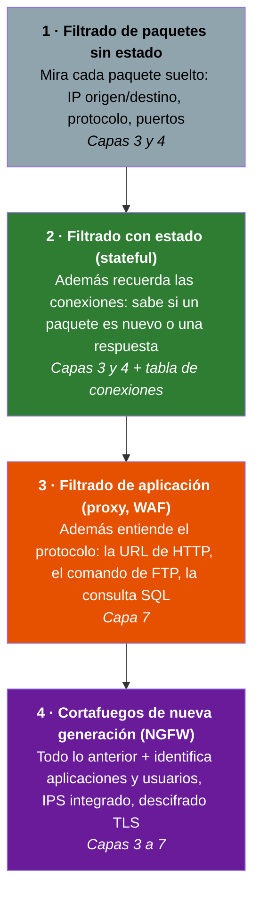
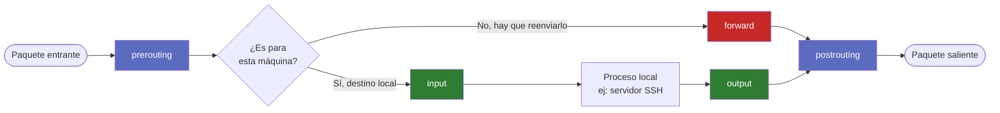
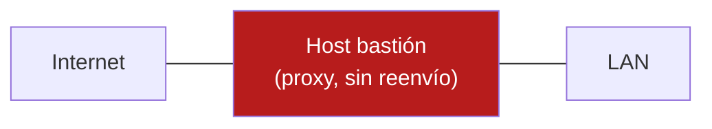
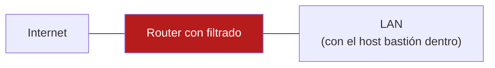
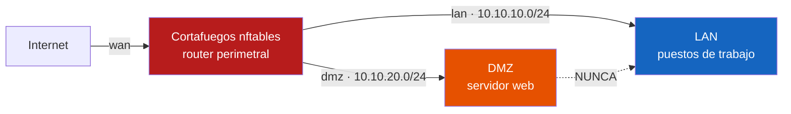
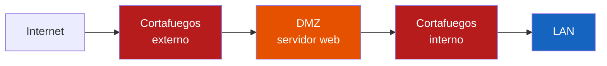

# UD 3: Cortafuegos Stateful y Filtrado Perimetral con nftables

!!! info "Ficha Técnica de la Unidad"
    * **Resultados de Aprendizaje (RA):** RA2 - Implementa mecanismos de seguridad pasiva y control de acceso a redes.
    * **Criterios de Evaluación (CE):**
        * **b)** Se ha configurado un cortafuegos en un sistema de filtrado de paquetes → bloques [1](#1-escribiendo-tus-primeras-reglas), [2](#2-conntrack-el-concepto-que-lo-cambia-todo), [5](#5-construyendo-el-ruleset-de-produccion-bloque-a-bloque) y [7](#7-monitorizar-y-depurar).
        * **c)** Se han descrito las arquitecturas de red seguras (DMZ) → [bloque 4](#4-arquitecturas-de-red-seguras).
        * **d)** Se han identificado los distintos niveles de filtrado → [apartado 0.2](#niveles-de-filtrado).
    * **Tecnologías Involucradas:** [NFTables](https://jmfiorisies.github.io/tech/nftables/)
    * **Marcos y Estándares:** ENS `mp.com.1` (Perímetro seguro), `mp.com.2` (Protección de la confidencialidad); CIS Benchmark Linux (sección Firewall Configuration); NIST SP 800-41 (Guidelines on Firewalls).

!!! tip "Cómo está organizada esta unidad"
    Es una unidad larga porque parte de cero, y el orden importa: cada bloque se apoya en el anterior.

    | Bloque | Qué aprendes |
    |---|---|
    | **0** | Qué es un cortafuegos, los **niveles de filtrado** y cómo recorre un paquete el kernel |
    | **1–2** | Escribir reglas a mano y entender **conntrack** (lo que hace a un cortafuegos *stateful*) |
    | **3** | Por qué nftables y no iptables (y cómo leer reglas de iptables) |
    | **4** | Las **arquitecturas de red seguras**: dónde se pone el cortafuegos y cómo se diseña |
    | **5** | El ruleset de un cortafuegos perimetral con DMZ, capa a capa |
    | **6** | El laboratorio en Docker |
    | **7–10** | Depurar, errores típicos, casos prácticos y glosario |

    Si ya conoces `iptables` o `nftables`, puedes leer en diagonal los bloques 1–3. Si es la primera vez que oyes hablar
    de un cortafuegos por reglas, **no te saltes nada**: el ruleset del bloque 5 no se entiende sin haber hecho antes el
    bloque 2 a mano.

---

## 📖 0. Fundamentos: ¿Qué es Realmente un Cortafuegos?

### 0.1 La analogía del portero

Imagina la entrada de un edificio de oficinas con un portero. El portero no lee el contenido de cada maletín que entra —
solo mira **de dónde viene la persona, a qué planta va, y si tiene una cita concertada**. Si alguien ya entró por la
mañana y ahora vuelve de la cafetería con su tarjeta de visitante, el portero le deja pasar sin volver a comprobarlo todo
desde cero, porque **recuerda que ya estableció esa relación** antes.

Un cortafuegos hace exactamente eso con los paquetes de red: **de dónde viene, hacia dónde va, por qué puerto, y si
pertenece a una conversación que ya empezó**. Esa última parte — recordar conversaciones — es lo que se llama
**stateful**, y es el concepto más importante de toda la unidad (bloque 2). Lo que el portero *no* hace es abrir los
maletines: eso es otro nivel de filtrado, el de aplicación, que tiene sus propias herramientas (UD5).

Un cortafuegos, en una frase: **un dispositivo o programa que separa dos o más redes (o una máquina del resto de la red)
y decide, según unas reglas, qué tráfico puede pasar de una a otra**. Todo lo demás de la unidad es *cómo* se escriben
esas reglas y *dónde* se coloca el cortafuegos.

### 0.2 Niveles de filtrado { #niveles-de-filtrado }

No todos los cortafuegos miran lo mismo. Según **cuánto del paquete** son capaces de mirar y **cuánto recuerdan**, se
distinguen varios niveles. Cada nivel incluye lo que hace el anterior y añade algo:



| Nivel | Qué mira | Qué decide bien | Qué **no** puede ver | Ejemplos |
|---|---|---|---|---|
| **1 · Paquetes sin estado** (*stateless*) | Cada paquete por separado: IPs, protocolo, puertos, flags TCP | «Al puerto 22 solo desde la LAN» | Si un paquete es la respuesta a algo que pediste. Para dejar pasar respuestas hay que abrir puertos de más | ACL de un router, `iptables` sin `-m state` |
| **2 · Con estado** (*stateful*) | Lo mismo + una **tabla de conexiones** | «Las respuestas a lo que yo he pedido, sí; lo que llegue sin que nadie lo pida, no» | El **contenido**: un ataque por el puerto 443 abierto pasa, porque el puerto está permitido | **nftables** (esta unidad), pf, el cortafuegos de un router doméstico |
| **3 · Aplicación** (proxy, WAF) | El **protocolo de aplicación**: la URL, las cabeceras, el cuerpo de la petición | «Peticiones HTTP sin `' OR 1=1` en los parámetros», «a esta web sí, a esta no» | Lo que va cifrado si no lo descifra; es más lento (procesa cada petición entera) | Squid (proxy), ModSecurity (WAF, UD5) |
| **4 · Nueva generación** (NGFW) | Todo, con identificación de aplicación («esto es WhatsApp aunque vaya por el 443») y usuario | Políticas por aplicación y usuario, IPS integrado | Es caro, complejo, y si descifra TLS hay que gestionar la confianza | Palo Alto, Fortinet, pfSense/OPNsense con módulos |

!!! example "El mismo ataque visto por cada nivel"
    Un atacante intenta una **inyección SQL** contra la web publicada: `GET /buscar?q=' OR 1=1 --` al puerto 443.

    * **Sin estado:** ve un paquete TCP al 443 del servidor web. El 443 está permitido → **pasa**.
    * **Con estado:** ve una conexión nueva al 443, permitida, y luego sus respuestas → **pasa**.
    * **Aplicación (WAF):** descifra y lee la petición HTTP, reconoce el patrón de inyección → **la bloquea**.

    Por eso **ningún nivel sustituye a los otros**: el cortafuegos de red decide *quién puede hablar con quién*; el WAF
    decide *qué se puede decir*. Es la **defensa en profundidad**: varias capas, cada una para lo suyo.

**Cortafuegos de red frente a cortafuegos de host.** Según **dónde** está:

| | Cortafuegos de **red** (perimetral) | Cortafuegos de **host** (personal) |
|---|---|---|
| Dónde está | Entre redes: hace de router (cadena `forward`) | En cada máquina: protege solo a esa (cadena `input`/`output`) |
| Qué protege | Redes enteras: la LAN, la DMZ | Esa máquina, también frente a su propia red |
| Ejemplos | El firewall del laboratorio de esta unidad | nftables/ufw/firewalld en un servidor, el Firewall de Windows |
| Se complementan | Si alguien entra en la LAN, el perimetral ya no le para | El de host para el movimiento lateral *dentro* de la red |

Con nftables se hacen los dos: la diferencia es **qué cadena** se usa (lo verás en el apartado 0.4).

**La política por defecto: lista blanca o lista negra.** Antes de escribir una sola regla hay que decidir qué pasa con
todo lo que *no* está en ninguna:

* **Lista negra** (*default allow*, `policy accept`): todo pasa salvo lo que se prohíbe. Cómodo, y peligroso: cualquier
  servicio que alguien arranque sin avisar queda expuesto, y siempre vas un paso por detrás del atacante.
* **Lista blanca** (*default deny*, `policy drop`): **nada pasa salvo lo que se permite expresamente**. Es la única
  aceptable en un cortafuegos de seguridad (CIS Benchmark, NIST SP 800-41 y ENS `mp.com.1` la exigen), y es la que se
  usa en toda esta unidad.

!!! question "Pregunta de control"
    Tu empresa tiene un cortafuegos *stateful* con el 443 abierto hacia el servidor web. ¿Protege contra un ataque de
    *cross-site scripting* en un formulario de la web?

    ??? success "Respuesta"
        No. El cortafuegos *stateful* trabaja en las capas 3 y 4: ve una conexión permitida al 443 y no lee el contenido
        de la petición. Para eso hace falta un nivel de aplicación (un WAF delante de la web), además de programar bien
        la aplicación.

### 0.3 Dónde vive el cortafuegos: Netfilter dentro del kernel

En Linux, el cortafuegos no es un programa que se ejecuta como un proceso más — es un conjunto de **puntos de
intercepción (hooks)** integrados directamente en el kernel, dentro del subsistema llamado **Netfilter**. Cuando un
paquete de red llega, atraviesa el kernel en un orden fijo, y en varios puntos de ese recorrido el kernel se detiene un
instante y pregunta: *"¿hay alguna regla que decida qué hacer con este paquete aquí?"*

`nftables` es **la herramienta que te permite escribir esas reglas** (con el programa `nft`) para que Netfilter las
consulte en cada uno de esos puntos. Su predecesor, `iptables`, hacía lo mismo con otra sintaxis (bloque 3).

### 0.4 El viaje de un paquete: los 5 hooks

Todo paquete que llega a una máquina Linux recorre un camino predecible. Este diagrama es el mapa mental más importante
de la unidad — vuelve a él cada vez que te pierdas:



| Hook | ¿Cuándo se recorre? | Ejemplo de uso típico |
|---|---|---|
| `prerouting` | Nada más entrar, antes de decidir si es para esta máquina o hay que reenviarlo | DNAT (redirigir un puerto público a un servidor interno) |
| `input` | El paquete es **para esta máquina** (ej. alguien te hace SSH a ti) | Cortafuegos de host: qué servicios expones |
| `forward` | El paquete **no es para esta máquina**, hay que reenviarlo a otra (esta máquina actúa de router) | Cortafuegos de red: todo el filtrado entre LAN, DMZ e Internet |
| `output` | El paquete **se genera en esta máquina** y sale hacia fuera | Controlar qué conexiones puede iniciar tu propio sistema |
| `postrouting` | Justo antes de salir físicamente por una interfaz | SNAT/masquerade (cambiar la IP origen para salir a Internet) |

!!! question "Pregunta de control"
    Si tu firewall hace de router entre tu LAN y una DMZ (el escenario de esta unidad), ¿por qué hook pasan los paquetes
    que van del PC de la LAN al servidor web de la DMZ: `input` o `forward`?

    ??? success "Respuesta"
        `forward`: el firewall no es el destino final del paquete, solo lo reenvía de una red a otra. Por `input` solo
        pasaría si el PC se conectara **al propio firewall** (por ejemplo, por SSH para administrarlo).

### 0.5 Los "verdicts": qué puede decidir una regla

Cada regla, al hacer *match* con un paquete, puede aplicar un **verdict** (veredicto):

| Verdict | Efecto | ¿Cuándo usarlo? |
|---|---|---|
| `accept` | Deja pasar el paquete **en esta cadena** | Tráfico legítimo identificado explícitamente |
| `drop` | Descarta el paquete **en silencio**, sin avisar al emisor | Política por defecto de seguridad — el atacante ni sabe si el puerto existe |
| `reject` | Descarta el paquete pero **responde** (un ICMP «puerto inaccesible» o un TCP RST) | Red interna, donde quieres que el cliente falle rápido en vez de esperar un timeout |
| `jump` / `goto` | Salta a otra cadena (con `jump` vuelve después; con `goto`, no) | Organizar el ruleset en cadenas propias (apartado 5.6) |
| `continue` / `return` | Sigue con la siguiente regla / vuelve a la cadena desde la que se saltó | Poco frecuentes |

Además, una regla puede tener acciones que **no** deciden y dejan seguir el paquete por las reglas siguientes: `counter`
(contarlo), `log` (apuntarlo en el registro del kernel) o `limit` (que solo coincida si no se pasa de una tasa).

!!! warning "drop vs. reject: una decisión de diseño, no un detalle menor"
    En un cortafuegos perimetral casi siempre se usa `drop`. Con `reject`, un atacante que escanea tu red obtiene una
    respuesta inmediata ("puerto cerrado, pero la máquina existe"). Con `drop`, el paquete desaparece sin más: el atacante
    no sabe si la IP existe, si el puerto está filtrado o si nadie le ha respondido por lentitud de red. Es la diferencia
    entre un edificio con un cartel que dice "prohibido el paso" y un edificio que, desde fuera, parece que no existe.
    Dentro de la LAN, en cambio, `reject` es más amable: el usuario ve «conexión rechazada» al momento en vez de esperar.

### 0.6 El orden: la primera regla que coincide, gana { #orden-de-evaluacion }

Es la regla de oro para leer y escribir cualquier cortafuegos:

1. Dentro de una cadena, las reglas se comprueban **de arriba abajo**.
2. **La primera regla cuyo verdict es definitivo (`accept`, `drop`, `reject`) decide**: las de debajo ya no se miran.
3. Si **ninguna** coincide, se aplica la **política** de la cadena (`policy drop` en esta unidad).

```text
chain forward { policy drop;
  1  iifname "lan" oifname "wan" accept          ← un paquete LAN→Internet acaba AQUÍ
  2  iifname "dmz" oifname "lan" drop            ← un paquete DMZ→LAN acaba AQUÍ
  3  iifname "wan" ip daddr 10.10.20.10 tcp dport 80 accept
}                                                ← un paquete Internet→LAN no coincide con nada: POLICY (drop)
```

Por eso **el orden es parte de la seguridad**: un `accept` demasiado amplio colocado antes que un `drop` específico anula
el `drop` sin dar ningún error. Y por eso las reglas que más paquetes deciden (`ct state established,related accept`,
bloque 2) van arriba: es también más rápido.

**¿Y si hay varias cadenas en el mismo hook?** Se pueden enganchar varias cadenas al mismo hook (por ejemplo, la de NAT
y la de filtrado en `prerouting`). El orden lo decide su **prioridad**: **menor número, antes**. nftables trae nombres
para las prioridades habituales, más legibles que los números:

| Nombre | Valor | Para qué |
|---|:-:|---|
| `dstnat` | −100 | DNAT en `prerouting` (cambiar el destino antes de decidir la ruta) |
| `filter` | 0 | Filtrado normal en `input`, `forward`, `output` |
| `srcnat` | 100 | SNAT/masquerade en `postrouting` |

!!! danger "Un `accept` no es definitivo en todo el kernel"
    Un `accept` solo termina **esa cadena**. Si hay otra cadena base en el mismo hook con prioridad posterior, el paquete
    también pasa por ella, y si esa lo tira, se tira. Un `drop`, en cambio, es definitivo: el paquete muere ahí. Por eso
    en esta unidad hay **una sola cadena de filtrado por hook**.

### 0.7 Vocabulario mínimo que necesitas ANTES de escribir una sola regla

| Término | Qué es |
|---|---|
| **table** | Contenedor de más alto nivel. Agrupa cadenas y conjuntos. Tiene una "familia" (`ip`, `ip6`, `inet` para ambas, `arp`, `bridge`, `netdev`) |
| **chain** | Una lista ordenada de reglas. Puede ser **base** (enganchada a un hook del kernel, con `type`, `hook` y `priority`) o **normal** (a la que saltas desde otra con `jump`) |
| **type** | Qué hace la cadena base: `filter` (filtrar), `nat` (traducir direcciones) o `route` |
| **hook** | El punto exacto del recorrido del paquete (ver 0.4) donde se engancha una cadena base |
| **priority** | Orden entre cadenas del mismo hook (menor número, antes) |
| **policy** | El verdict **por defecto** de una cadena base si ninguna regla decide (normalmente `drop`) |
| **rule** | Una o varias condiciones (*matches*) + acciones + un verdict. Ej: `tcp dport 22 accept` |
| **set / map** | Conjuntos de valores (IPs, puertos…) y tablas valor → valor, que se consultan de una vez (5.6) |

---

## 🧱 1. Escribiendo tus Primeras Reglas { #1-escribiendo-tus-primeras-reglas }

Ahora sí, con el vocabulario claro, vamos a construir un cortafuegos **desde la nada**, regla a regla, en modo interactivo
(sin fichero todavía). Es un cortafuegos **de host**: protege a la propia máquina (cadena `input`).

### 1.1 Instalación y primer vistazo

```bash title="Instalación y estado inicial" linenums="1"
apt install nftables
systemctl enable --now nftables

# Ver qué hay configurado (al principio, nada)
nft list ruleset
```

### 1.2 Crear una tabla y una cadena vacías

```bash title="Paso 1: crear la estructura" linenums="1"
# Una tabla llamada "filtro" para la familia inet (IPv4 e IPv6 a la vez)
nft add table inet filtro

# La cadena "input", enganchada al hook input, con política por defecto DROP
nft add chain inet filtro input '{ type filter hook input priority filter; policy drop; }'
```

!!! danger "El error más común y más peligroso de toda la unidad"
    Si estás conectado por SSH a una máquina remota y ejecutas el comando anterior (`policy drop` en `input` sin haber
    añadido antes ninguna regla que permita SSH), **te vas a quedar fuera de tu propia máquina**. El cortafuegos no
    distingue "soy yo, el administrador" — solo ve un paquete TCP al puerto 22 y, si no hay ninguna regla que lo acepte,
    lo descarta. Le ha pasado a prácticamente todo administrador alguna vez. Formas seguras de probar:

    1. Trabaja desde la **consola local** (no por SSH) mientras construyes las reglas base.
    2. Crea la cadena con `policy accept`, añade las reglas que permiten tu SSH, y **después** cambia la política:
       `nft chain inet filtro input '{ policy drop; }'`.
    3. En remoto, programa la marcha atrás **antes** de aplicar: `echo 'nft flush ruleset' | at now + 5 minutes`. Si todo
       va bien, la cancelas con `atrm`; si te quedas fuera, en 5 minutos se deshace sola.

### 1.3 Permitir lo esencial

```bash title="Paso 2: reglas mínimas de sentido común" linenums="1"
# El tráfico interno de la propia máquina (loopback) SIEMPRE debe permitirse
nft add rule inet filtro input iif lo accept

# Las respuestas a lo que esta máquina ha pedido (lo explica el bloque 2)
nft add rule inet filtro input ct state established,related accept

# SSH para no perder el acceso administrativo
nft add rule inet filtro input tcp dport 22 accept

# Comprobamos el resultado
nft list ruleset
```

Con estas reglas ya tienes un cortafuegos real: todo lo demás dirigido a esta máquina se descarta, salvo loopback, las
respuestas y SSH. Es primitivo, pero es exactamente el mismo mecanismo que usa el ruleset de producción del bloque 5.

### 1.4 Las condiciones (*matches*) que más vas a usar

Una regla puede llevar varias condiciones seguidas: **tienen que cumplirse todas** (es un «y»). Para un «o», se usa un
**conjunto** entre llaves `{ }`.

| Condición | Significado | Ejemplo |
|---|---|---|
| `ip saddr` / `ip daddr` | IP de origen / destino (IPv4). Admite redes y rangos | `ip saddr 10.10.10.0/24` |
| `ip6 saddr` / `ip6 daddr` | Lo mismo en IPv6 | `ip6 saddr fe80::/10` |
| `tcp dport` / `udp dport` | Puerto de destino (`sport`, de origen) | `tcp dport { 80, 443 }` · `tcp dport 1024-65535` |
| `iifname` / `oifname` | Nombre de la interfaz de entrada / salida (texto) | `iifname "lan"` |
| `iif` / `oif` | Interfaz por su **índice**: la interfaz **tiene que existir** al cargar | `iif lo` |
| `meta l4proto` | Protocolo de transporte, sea IPv4 o IPv6 | `meta l4proto { tcp, udp }` |
| `icmp type` / `icmpv6 type` | Tipo de mensaje ICMP | `icmp type echo-request` |
| `ct state` | Estado de la conexión (bloque 2) | `ct state new` |
| `tcp flags` | Flags TCP | `tcp flags syn` |
| `!=` | Negación | `ip saddr != 10.10.10.0/24` |

```bash title="Ejemplos combinando condiciones" linenums="1"
# SSH solo desde la LAN de administración (las dos condiciones a la vez)
nft add rule inet filtro input ip saddr 10.10.10.0/24 tcp dport 22 accept

# Web en los dos puertos (un conjunto: es un "o")
nft add rule inet filtro input tcp dport { 80, 443 } accept

# Todo lo que venga de una red concreta, a la basura
nft add rule inet filtro input ip saddr 198.51.100.0/24 drop
```

!!! tip "`iif` o `iifname`"
    `iif lo` compara el **número interno** de la interfaz: es muy rápido, pero si la interfaz no existe cuando se carga la
    regla, el fichero **no carga** («Interface does not exist»). `iifname "wan"` compara el **nombre**: algo más lento,
    pero funciona aunque la interfaz aparezca después (una VPN `wg0`, una interfaz USB). Regla práctica: `iif lo` para
    loopback, que siempre existe; `iifname` para todo lo demás. En el laboratorio se usa `iifname`.

### 1.5 Dónde se añade una regla: `add`, `insert` y los `handle`

Como **el orden importa** (0.6), no da igual dónde se añade una regla:

```bash title="Colocar una regla en su sitio" linenums="1"
nft add rule inet filtro input tcp dport 443 accept       # al FINAL de la cadena
nft insert rule inet filtro input tcp dport 80 accept     # al PRINCIPIO de la cadena

nft -a list chain inet filtro input                        # -a enseña el "handle" (número) de cada regla
#   tcp dport 80 accept  # handle 3
#   tcp dport 22 accept  # handle 2

nft add rule inet filtro input position 2 tcp dport 8080 accept   # DESPUÉS de la regla con handle 2
nft delete rule inet filtro input handle 3                        # borrar una regla concreta
```

!!! warning "Una regla añadida al final, después de un drop, no sirve de nada"
    Si tu cadena termina en `counter drop` (como las del bloque 5) y haces `nft add rule … accept`, la regla nueva queda
    **detrás** del `drop` y nunca se evalúa. Usa `insert`, `position` o, mejor, edita el fichero (1.6) y recárgalo.

### 1.6 De lo interactivo a lo declarativo: el fichero `.conf`

Escribir regla a regla con `nft add` es didáctico, pero poco práctico y nada reproducible: al reiniciar, todo se pierde.
En producción, se define **todo el ruleset en un fichero** y se carga de una vez:

```bash title="/etc/nftables.conf (versión mínima)" linenums="1"
#!/usr/sbin/nft -f

flush ruleset

table inet filtro {
    chain input {
        type filter hook input priority filter; policy drop;
        iif lo accept
        ct state established,related accept
        tcp dport 22 accept
    }
}
```

```bash title="Comprobar, cargar y hacerlo permanente" linenums="1"
nft -c -f /etc/nftables.conf     # -c: solo COMPRUEBA la sintaxis, no carga nada
nft -f /etc/nftables.conf        # carga el fichero entero
systemctl enable nftables        # al arrancar, el servicio carga /etc/nftables.conf
```

!!! note "flush ruleset y la carga atómica"
    `flush ruleset` vacía toda la configuración anterior antes de aplicar la nueva. Así el fichero es **idempotente**:
    puedes cargarlo 100 veces y el resultado es siempre el mismo, sin reglas duplicadas. Y como `nft -f` aplica todo el
    fichero **en una sola transacción**, si hay un error no se carga **nada** (se queda lo que había) y nunca hay un
    instante con el cortafuegos a medio cargar.

### 1.7 Comandos de consulta que usarás constantemente

```bash title="Comandos de trabajo diario" linenums="1"
nft list ruleset                       # toda la configuración activa
nft list table inet filtro             # solo una tabla
nft -a list ruleset                    # con los handles de cada regla
nft list ruleset > copia-$(date +%F).nft   # copia de seguridad de lo que hay cargado
nft flush ruleset                      # vaciar TODO (cuidado: con policy drop por medio, te quedas fuera)
```

Para que una regla **cuente** los paquetes que coinciden con ella, añade `counter`. Es la mejor herramienta para saber
si una regla está actuando (bloque 7):

```bash
nft add rule inet filtro input tcp dport 22 counter accept
nft list chain inet filtro input
#   tcp dport 22 counter packets 41 bytes 3120 accept
```

---

## 🔄 2. Conntrack: el Concepto que lo Cambia Todo { #2-conntrack-el-concepto-que-lo-cambia-todo }

### 2.1 El problema que resuelve

Con un cortafuegos que solo permite el puerto 22 de entrada, ¿qué pasa cuando **tú** navegas por Internet desde esa
máquina? Tu navegador sale de un puerto alto cualquiera (por ejemplo, el 51234) hacia el 443 de un servidor web. El
servidor te responde **desde su 443 hacia tu 51234**, y esa respuesta **entra** por `input`. Si solo permitiste el 22,
la respuesta se descarta: tu propia navegación deja de funcionar.

La solución "ingenua" (y mala) sería abrir todos los puertos altos de entrada (1024-65535) para permitir cualquier
respuesta. Es exactamente lo que tenían que hacer los cortafuegos **sin estado** (0.2), y es un agujero enorme: cualquier
atacante puede mandar tráfico a esos puertos "abiertos por si acaso".

### 2.2 La solución: recordar las conversaciones

Netfilter mantiene en memoria una **tabla de conexiones** (**conntrack**, de *connection tracking*) donde apunta cada
conversación que pasa por la máquina: quién la empezó, desde qué IP y puerto, hacia dónde. Con ella clasifica cada
paquete en un **estado**:

| Estado | Significado | Ejemplo |
|---|---|---|
| `new` | Primer paquete de una conexión que conntrack no conoce | El SYN inicial de una conexión TCP |
| `established` | Pertenece a una conexión ya vista **en las dos direcciones** | La respuesta SYN-ACK y todos los paquetes siguientes |
| `related` | No es la misma conexión, pero está *relacionada* con una existente | Un error ICMP sobre una conexión tuya; el canal de datos de FTP |
| `invalid` | No encaja en ningún estado coherente | Un ACK de una conexión que nunca existió, flags TCP imposibles |
| `untracked` | Se ha marcado expresamente para no seguirlo | Rara vez (tráfico masivo que no se quiere apuntar) |

**El saludo TCP visto por conntrack.** Así entiende conntrack una conexión de tu PC a una web:

```text
PC 10.10.10.5:51234  ──SYN──────▶  web 93.184.216.34:443     conntrack: nueva entrada · estado new
PC                   ◀──SYN-ACK──  web                        la respuesta ya es established
PC                   ──ACK──────▶  web                        established
         … datos en los dos sentidos …                        established
PC                   ──FIN──────▶  web   …                    la entrada se cierra y, tras un tiempo, se borra
```

**¿Y UDP o ICMP, que no tienen conexión?** conntrack se la inventa: el primer paquete UDP de un origen a un destino es
`new`; si vuelve un paquete con las direcciones y puertos al revés **en poco tiempo**, la «conexión» pasa a
`established`. Igual con un `ping` (echo-request → echo-reply). Por eso funcionan solas las respuestas DNS (UDP 53) y los
pings que tú haces.

**Los tiempos.** Las entradas no son eternas: una conexión TCP establecida dura hasta 5 días sin tráfico; una
«conexión» UDP, unos 30 segundos (120 si hay tráfico en los dos sentidos). Pasado ese tiempo sin paquetes, la entrada se
borra y el siguiente paquete vuelve a ser `new`.

```bash title="Ver la tabla de conexiones (paquete conntrack)" linenums="1"
apt install conntrack
conntrack -L                     # todas las conexiones seguidas ahora mismo
conntrack -L -p tcp --dport 22   # solo las de SSH
conntrack -E                     # en directo: cada conexión nueva, actualizada o borrada
```

```text
tcp  6 431999 ESTABLISHED src=10.10.10.5 dst=10.10.10.254 sport=51234 dport=22 src=10.10.10.254 dst=10.10.10.5 sport=22 dport=51234 [ASSURED]
       ▲ segundos que le quedan   ▲ ida (quien empezó)                         ▲ vuelta (la respuesta esperada)
```

### 2.3 La regla que lo soluciona todo

```bash title="La regla stateful más importante de cualquier cortafuegos" linenums="1"
# Va SIEMPRE muy cerca del principio de la cadena
ct state invalid drop                       # lo que no tiene sentido, fuera
ct state established,related accept         # las respuestas y lo relacionado, dentro
```

Con estas dos líneas, la máquina puede **iniciar** conexiones libremente (si lo permiten `output` o `forward`), y las
respuestas se aceptan solas, sin abrir ningún puerto más. A partir de aquí, **el resto de reglas solo tiene que decidir
qué conexiones nuevas se permiten**. Esto es, literalmente, la diferencia entre un cortafuegos profesional y uno de
juguete.

!!! tip "Analogía final de conntrack"
    Volviendo al portero del edificio: `ct state established` es el portero diciendo *"ah sí, usted salió hace un momento
    a por un café, adelante"*. `ct state new` es *"usted no lo había visto entrar nunca, deje que consulte si tiene
    autorización"*. `ct state invalid` es *"usted dice que ya había entrado, pero mis registros no cuadran — no pasa"*.

!!! note "Por qué `invalid` va antes que `established`"
    Un paquete `invalid` nunca es `established`, así que el orden entre esas dos líneas no cambia el resultado. Se pone
    primero por claridad y por costumbre de auditoría: lo que es basura se tira antes de mirar nada más. Lo importante es
    que **las dos vayan arriba**, antes de cualquier regla de `ct state new`.

### 2.4 ¿Bloqueo todo el ICMP? No

Muchos tutoriales antiguos recomiendan «bloquear el ping» y, de paso, todo el ICMP. Es un error: ICMP no es solo el
`ping`, es el **sistema de avisos de la red**, y algunos de sus mensajes son imprescindibles:

| Mensaje | Para qué sirve | Si lo bloqueas… |
|---|---|---|
| `destination-unreachable` (con *fragmentation needed*) | **PMTU discovery**: el router avisa de que el paquete es demasiado grande para el camino | Conexiones que se cuelgan al mandar paquetes grandes (la web carga a medias, SSH se queda congelado al hacer `ls`) |
| `time-exceeded` | El TTL llegó a 0 (bucles de rutas, `traceroute`) | `traceroute` deja de funcionar y diagnosticar es más difícil |
| `echo-request` / `echo-reply` | `ping` | No pasa nada grave, pero perder el ping complica el diagnóstico sin ganar casi seguridad |
| ICMPv6 *neighbor solicitation/advertisement*, *router advertisement* | En IPv6 **sustituyen a ARP**: sin ellos no se sabe la MAC del vecino | **IPv6 deja de funcionar** del todo |
| ICMPv6 `packet-too-big` | El PMTU de IPv6 (los routers IPv6 no fragmentan) | Lo mismo que el primero, pero peor |

Los errores ICMP de las conexiones en curso son `related`, así que la regla del 2.3 ya los deja pasar. Lo que hay que
permitir a mano es el `ping` (limitado) y, en IPv6, el descubrimiento de vecinos:

```bash title="ICMP razonable en input" linenums="1"
icmp type echo-request limit rate 5/second accept
icmpv6 type { echo-request, nd-neighbor-solicit, nd-neighbor-advert, nd-router-advert, packet-too-big } accept
```

!!! question "Pregunta de control"
    ¿Por qué no hace falta una regla para dejar pasar los `echo-reply` cuando **tú** haces ping a otra máquina?

    ??? success "Respuesta"
        Porque tu `echo-request` crea una entrada en conntrack, y el `echo-reply` que vuelve es `established`: lo deja
        pasar la regla `ct state established,related accept`.

---

## ⚖️ 3. De iptables a nftables

Ya sabes escribir reglas nftables. Ahora, por qué esta herramienta sustituyó a su predecesora, `iptables`, que verás
mencionada constantemente en documentación, foros y sistemas heredados.

**nftables** es el sucesor oficial de iptables desde el kernel 3.13 (2014) y la herramienta por defecto en Debian desde
la versión 10. Unifica IPv4, IPv6, ARP y bridge en un único framework, con sintaxis declarativa y mejor rendimiento.

| Aspecto | iptables | nftables |
|---|---|---|
| Programas | Uno por familia: `iptables`, `ip6tables`, `arptables`, `ebtables` | Uno solo: `nft` |
| Tablas y cadenas | Predefinidas (`filter`, `nat`, `INPUT`, `FORWARD`…) | Las creas tú, con el nombre que quieras |
| IPv4/IPv6 | Reglas por duplicado | Familia `inet`: una regla para las dos |
| Muchas IPs o puertos | Una regla por valor (o el módulo aparte `ipset`) | Conjuntos y mapas integrados, con búsqueda por hash |
| Recarga | No atómica: hay un instante con reglas a medias | Atómica: todo o nada |
| Contadores | Siempre, en todas las reglas | Solo donde pones `counter` |

**Leer reglas de iptables.** Las vas a encontrar en guías y en sistemas antiguos. Esta es la equivalencia de las más
típicas:

| iptables | nftables |
|---|---|
| `iptables -P INPUT DROP` | `chain input { type filter hook input priority filter; policy drop; }` |
| `iptables -A INPUT -i lo -j ACCEPT` | `iif lo accept` |
| `iptables -A INPUT -m conntrack --ctstate ESTABLISHED,RELATED -j ACCEPT` | `ct state established,related accept` |
| `iptables -A INPUT -p tcp --dport 22 -s 10.10.10.0/24 -j ACCEPT` | `ip saddr 10.10.10.0/24 tcp dport 22 accept` |
| `iptables -A INPUT -p tcp -m multiport --dports 80,443 -j ACCEPT` | `tcp dport { 80, 443 } accept` |
| `iptables -A FORWARD -i eth1 -o eth2 -j DROP` | `iifname "eth1" oifname "eth2" drop` |
| `iptables -t nat -A POSTROUTING -o eth0 -j MASQUERADE` | `oifname "eth0" masquerade` (en una cadena `type nat hook postrouting`) |
| `iptables -t nat -A PREROUTING -i eth0 -p tcp --dport 80 -j DNAT --to 10.10.20.10` | `iifname "eth0" tcp dport 80 dnat to 10.10.20.10` (en `type nat hook prerouting`) |
| `iptables -A INPUT -j LOG --log-prefix "drop: "` | `log prefix "drop: "` |

Si tienes que migrar, no hace falta traducir a mano: `iptables-translate` convierte una regla e
`iptables-restore-translate -f reglas.v4` un fichero entero:

```bash
iptables-translate -A INPUT -p tcp --dport 22 -s 10.10.10.0/24 -j ACCEPT
# nft 'add rule ip filter INPUT ip saddr 10.10.10.0/24 tcp dport 22 counter accept'
```

!!! note "¿Por qué seguirás viendo iptables?"
    Por herencia: guías antiguas, scripts que nadie ha migrado y herramientas como Docker, que todavía usan la sintaxis
    de iptables. En Debian moderno, el comando `iptables` es en realidad `iptables-nft`: escribe reglas de nftables por
    debajo (las verás con `nft list ruleset`). El caso práctico 3 del final trata de un problema real de iptables: la
    recarga no atómica.

---

## 🏛️ 4. Arquitecturas de Red Seguras { #4-arquitecturas-de-red-seguras }

Saber escribir reglas no basta: antes hay que decidir **dónde se pone el cortafuegos** y **cómo se reparte la red**. A
eso se le llama **arquitectura de red segura**.

### 4.1 La idea de partida: zonas de confianza

Una red no es un bloque: tiene partes que merecen **distinta confianza**. Se agrupan en **zonas**, y el cortafuegos
controla qué tráfico cruza de una zona a otra:

| Zona | Confianza | Qué hay |
|---|---|---|
| **Internet** (WAN) | Ninguna | Todo el mundo, incluidos los atacantes |
| **DMZ** (zona desmilitarizada) | Baja | Los servidores que **tienen** que verse desde Internet: web, correo, DNS público |
| **LAN** (red interna) | Alta | Los puestos de trabajo y los servidores internos: lo que hay que proteger |

**La idea central de una DMZ:** los servicios publicados en Internet son, por definición, los más expuestos. Si uno de
ellos se compromete, **no debe convertirse en una puerta de entrada a la red interna**. Por eso viven en una red aparte,
y la regla de oro es: **desde Internet se llega a la DMZ, pero desde la DMZ no se llega a la LAN**.

### 4.2 Las arquitecturas clásicas

De la más sencilla a la más robusta. Todas se pueden montar con nftables; lo que cambia es cuántos cortafuegos hay y
dónde.

**a) Host bastión de dos patas (*dual-homed host*).** Una sola máquina con dos interfaces, una a Internet y otra a la LAN,
que no reenvía paquetes: todo pasa por servicios (proxy) que corren en ella.



**b) *Screened host* (host apantallado).** Un router con filtrado de paquetes protege la red, y dentro de la LAN hay un
**host bastión** (por ejemplo, el servidor de correo), que es el único al que el router deja llegar desde Internet.



**c) Cortafuegos de tres patas (*three-legged firewall*).** Un solo cortafuegos con **tres interfaces**: Internet, DMZ y
LAN. Es la arquitectura del laboratorio de esta unidad, y la más habitual en pymes.



**d) Subred apantallada con dos cortafuegos (*screened subnet*, *back-to-back*).** La DMZ queda **entre dos
cortafuegos**: el externo separa Internet de la DMZ y el interno separa la DMZ de la LAN. Para llegar a la LAN, un
atacante tiene que superar **los dos**. Si son de **fabricantes distintos**, un mismo fallo no sirve para los dos.



| Arquitectura | Cortafuegos | Ventajas | Inconvenientes | Cuándo |
|---|:-:|---|---|---|
| Host bastión de dos patas | 1 (sin reenvío) | Sencilla; todo pasa por servicios controlados | Si cae el bastión, cae todo; solo sirve para servicios con proxy | Redes muy pequeñas, casos antiguos |
| *Screened host* | 1 router | Barata | El bastión está **dentro** de la LAN: si lo comprometen, ya están dentro | Casi en desuso |
| Tres patas | 1 | Un solo equipo; DMZ separada; fácil de administrar | **Punto único de fallo**: si alguien toma el cortafuegos, controla las tres zonas | Pymes, la más común |
| Subred apantallada (dos cortafuegos) | 2 | **Defensa en profundidad**: hay que superar dos barreras distintas | Más cara y más compleja (dos rulesets que mantener) | Empresas medianas y grandes, administración pública (ENS categoría ALTA) |

!!! note "Normativa (ENS)"
    La medida `mp.com.1` del ENS exige, para los sistemas de categoría MEDIA y ALTA, un **punto de interconexión
    controlado** con las redes externas, y que los servicios accesibles desde el exterior se ubiquen en una **DMZ**
    aislada del resto de la red interna, con reglas explícitas de qué tráfico puede cruzar cada segmento.

### 4.3 Diseñar antes de escribir: la matriz de zonas

Antes de escribir una sola regla, un profesional apunta **qué tráfico debe cruzar de cada zona a cada zona**. Esa tabla es
el diseño del cortafuegos, y la cadena `forward` sale de ella casi regla a regla. Esta es la del laboratorio:

| Desde ↓ · Hacia → | Internet | DMZ | LAN |
|---|---|---|---|
| **Internet** | — | Solo la web: TCP 80 y 443 al servidor `10.10.20.10` (con DNAT) | **Nada** |
| **DMZ** | Solo HTTPS (443), para actualizarse | — | **Nada** (la regla más importante) |
| **LAN** | Todo (navegar) | SSH (22) al servidor web, para administrarlo | — |
| **El propio cortafuegos** (input) | Nada | Nada | SSH (22) con límite, ping |

Cada casilla con algo se convierte en una regla `accept`; cada casilla con **Nada** la cubre la política `drop` (y, para
las críticas, una regla `drop` explícita). Ya no se trata de «qué reglas pongo», sino de **traducir una decisión de
negocio**. Y cuando alguien pida abrir algo nuevo, se discute sobre la matriz, no sobre el fichero.

!!! question "Pregunta de control"
    En la arquitectura de tres patas, ¿qué pasa si un atacante consigue el control del propio cortafuegos? ¿Y en la de
    dos cortafuegos?

    ??? success "Respuesta"
        Con tres patas, controla las tres zonas a la vez: puede cambiar las reglas y llegar a la LAN. Es el punto único de
        fallo. Con dos cortafuegos, controlar el externo le da la DMZ, pero para la LAN aún tiene que superar el interno,
        que tiene sus propias reglas (y mejor si es de otro fabricante).

---

## ⚙️ 5. Construyendo el Ruleset de Producción, Bloque a Bloque { #5-construyendo-el-ruleset-de-produccion-bloque-a-bloque }

Ahora vas a construir —pieza a pieza— el cortafuegos de **tres patas** de la matriz anterior. Los nombres son los del
laboratorio (bloque 6): las interfaces se llaman `wan`, `dmz` y `lan`, y el servidor web es `10.10.20.10`.

```bash title="Las definiciones del principio del fichero" linenums="1"
define WAN = "wan"
define DMZ = "dmz"
define LAN = "lan"
define WEB = 10.10.20.10
```

`define` crea **variables**: si mañana cambia la IP del servidor web, se cambia en un solo sitio.

### 5.1 Capa 1 — La cadena `input`: proteger al propio cortafuegos

```bash title="input: solo lo imprescindible para administrar el cortafuegos" linenums="1"
chain input {
    type filter hook input priority filter; policy drop;

    # Los pilares de los bloques 1 y 2
    ct state invalid drop comment "estados de conexión inválidos"
    ct state established,related accept
    iif lo accept

    # ICMP razonable (2.4): ping limitado y lo imprescindible de IPv6
    icmp type echo-request limit rate 5/second accept
    icmpv6 type { echo-request, nd-neighbor-solicit, nd-neighbor-advert, nd-router-advert, packet-too-big } accept

    # SSH solo desde la LAN, con límite de intentos (mitiga la fuerza bruta)
    iifname $LAN tcp dport 22 ct state new limit rate 4/minute accept comment "SSH solo desde la LAN, con límite"

    # Registrar lo que se descarta, para poder investigarlo después (bloque 7)
    limit rate 5/minute log prefix "nft-input-drop: "
    counter drop
}
```

**Novedades respecto al bloque 1:**

* `limit rate 4/minute`: **rate limiting**. No basta con permitir SSH: se limita cuántas conexiones **nuevas** se aceptan
  por minuto. A partir de la quinta en un minuto, la regla deja de coincidir, el paquete sigue bajando y acaba en el
  `drop` del final. Un ataque de fuerza bruta pasa de miles de intentos por minuto a cuatro.
* `limit rate 5/minute log prefix …`: apunta en el registro del kernel lo que se va a tirar, pero **como mucho cinco
  líneas por minuto**. Sin el `limit`, un escaneo llenaría el disco de logs (que también es una forma de ataque).
* `counter drop` al final, en vez de fiarse solo de la política: el `drop` es el mismo, pero con el `counter` sabes
  cuántos paquetes se han tirado.

### 5.2 Capa 2 — La cadena `forward`: el corazón de la segmentación

Aquí ocurre el aislamiento entre zonas. Es la **matriz del apartado 4.3**, fila a fila:

```bash title="forward: la matriz de zonas, regla a regla" linenums="1"
chain forward {
    type filter hook forward priority filter; policy drop;

    ct state invalid drop
    ct state established,related accept

    # LAN -> Internet: los usuarios navegan
    iifname $LAN oifname $WAN accept comment "LAN -> Internet"

    # LAN -> DMZ: SOLO administrar el servidor web por SSH
    iifname $LAN oifname $DMZ ip daddr $WEB tcp dport 22 ct state new accept comment "LAN administra la web"

    # Internet -> DMZ: SOLO el servicio publicado
    iifname $WAN oifname $DMZ ip daddr $WEB tcp dport { 80, 443 } ct state new accept comment "web publicada"

    # DMZ -> LAN: EXPLÍCITAMENTE DENEGADO
    iifname $DMZ oifname $LAN counter drop comment "aislamiento DMZ -> LAN"

    # DMZ -> Internet: solo lo justo para actualizarse
    iifname $DMZ oifname $WAN tcp dport 443 ct state new accept comment "la web solo sale a actualizarse"

    limit rate 5/minute log prefix "nft-forward-drop: "
    counter drop
}
```

!!! danger "La regla más crítica de toda la unidad"
    `iifname $DMZ oifname $LAN counter drop` es la directiva de aislamiento más importante. Sin ella (y con alguna regla
    demasiado amplia más arriba), un atacante que comprometa el servidor web tendría vía libre hacia la red interna. Fíjate
    en que la política ya es `drop`, y aun así se añade la regla **explícita**: en seguridad, la intención se escribe, no se
    deja implícita. Así la ve cualquiera que audite el fichero, y su `counter` te dice si alguien lo está intentando
    (bloque 7).

!!! tip "Filtrar también la salida (*egress*)"
    Fíjate en que la DMZ **no** puede salir a Internet por cualquier puerto: solo por el 443. Si un atacante toma el
    servidor web, lo primero que intentará es conectarse a su propio servidor para recibir órdenes o sacar datos. Con la
    salida cerrada, lo tiene mucho más difícil. Lo mismo con el DNS: en una empresa real, la DMZ solo debería poder
    consultar **el DNS de la empresa**, nunca uno cualquiera de Internet (los túneles DNS son una forma clásica de sacar
    datos, caso práctico 2):

    ```bash
    define DNS_EMPRESA = 10.10.20.53
    iifname $DMZ ip daddr $DNS_EMPRESA udp dport 53 accept   # (en el laboratorio no existe este servidor)
    ```

!!! tip "Anti-spoofing por regla"
    Por la interfaz de Internet nunca puede llegar un paquete que diga venir de tu red interna ni de redes privadas: si
    llega, es falso (*spoofing*). El kernel ya lo frena con `rp_filter` (5.5), pero se puede escribir también como regla,
    al principio de `forward` y de `input`:

    ```bash
    iifname $WAN ip saddr { 10.0.0.0/8, 172.16.0.0/12, 192.168.0.0/16, 127.0.0.0/8 } counter drop comment "anti-spoofing"
    ```

### 5.3 Capa 3 — NAT: traducir direcciones para que todo funcione

Los equipos de la LAN y la DMZ tienen IPs privadas (`10.10.x.x`) que no existen en Internet. Hace falta **NAT** en los dos
sentidos:

* **SNAT** (*source NAT*, cambia el **origen**): cuando la LAN sale a Internet, el cortafuegos sustituye la IP privada
  por la suya pública. El servidor de Internet responde a la IP pública, y conntrack deshace el cambio al volver.
* **DNAT** (*destination NAT*, cambia el **destino**): cuando alguien de Internet llega a la IP pública del cortafuegos
  en el puerto 80, se le redirige al servidor web real de la DMZ. Es **publicar** un servicio.

```bash title="tabla nat: prerouting (DNAT) y postrouting (SNAT)" linenums="1"
table ip nat {
    chain prerouting {
        type nat hook prerouting priority dstnat;
        # DNAT: la IP pública del cortafuegos en 80/443 -> el servidor web de la DMZ
        iifname $WAN tcp dport { 80, 443 } dnat to $WEB
    }

    chain postrouting {
        type nat hook postrouting priority srcnat;
        # SNAT dinámico: lo que sale a Internet, con la IP pública del cortafuegos
        oifname $WAN masquerade
    }
}
```

**Relaciónalo con el mapa del apartado 0.4:** el DNAT de `prerouting` ocurre **antes** de `forward`, así que cuando la regla
«web publicada» compara `ip daddr $WEB`, el paquete **ya** lleva como destino la IP interna. Por eso esa regla compara con
la IP de la DMZ y no con la pública. El `masquerade` de `postrouting` ocurre **después** de `forward`, justo al salir.

!!! danger "El DNAT no abre nada"
    El DNAT solo **cambia el destino**. Para que el paquete llegue, la cadena `forward` lo tiene que **dejar pasar**. Si
    pones el DNAT y te olvidas de la regla «web publicada», la web no responde (es el error más típico del laboratorio).

**`masquerade` o `snat to`.** Las dos hacen SNAT:

| | `masquerade` | `snat to 203.0.113.254` |
|---|---|---|
| Qué IP pone | La que tenga la interfaz de salida **en ese momento** | La que tú escribes |
| Cuándo | IP pública **dinámica** (fibra doméstica, DHCP) | IP pública **fija** (lo normal en una empresa): es algo más rápido |

**Otros usos del NAT que verás:**

```bash title="Variaciones habituales" linenums="1"
# DNAT con cambio de puerto: el 8080 público va al 80 del servidor web
iifname $WAN tcp dport 8080 dnat to $WEB:80

# SNAT con IP fija, solo para las redes internas
oifname $WAN ip saddr 10.10.0.0/16 snat to 203.0.113.254
```

!!! note "NAT en horquilla (*hairpin NAT*)"
    Un caso que confunde: un PC **de la LAN** intenta entrar en la web de la empresa usando la **IP pública**. El DNAT solo
    está en la interfaz `wan`, y el paquete entra por `lan`: no se traduce y no llega. Hay dos soluciones: un DNS interno
    que resuelva el nombre de la web a la IP **privada** de la DMZ (lo recomendable), o NAT en horquilla (aplicar también
    el DNAT y un SNAT al tráfico de la LAN hacia la IP pública). Si un alumno dice «desde fuera la web va, pero desde
    dentro no», es esto.

### 5.4 Ruleset completo consolidado

El fichero completo, con las tres capas juntas. Es el mismo que has construido en 5.1 a 5.3, con dos añadidos: el `set`
de IPs bloqueadas y la cadena `output`. Es también la solución del laboratorio:

```bash title="/etc/nftables.conf" linenums="1"
#!/usr/sbin/nft -f
# Cortafuegos perimetral de tres patas: Internet (wan), DMZ (dmz) y LAN (lan)
flush ruleset

define WAN = "wan"
define DMZ = "dmz"
define LAN = "lan"
define WEB = 10.10.20.10

table inet filtro {

    # IPs bloqueadas temporalmente (las puede añadir fail2ban, UD6, o tú a mano)
    set lista_negra {
        type ipv4_addr
        flags interval, timeout
        timeout 1h
    }

    chain input {
        type filter hook input priority filter; policy drop;
        ct state invalid drop comment "estados de conexión inválidos"
        ct state established,related accept
        iif lo accept
        ip saddr @lista_negra drop comment "IPs bloqueadas"
        icmp type echo-request limit rate 5/second accept
        icmpv6 type { echo-request, nd-neighbor-solicit, nd-neighbor-advert, nd-router-advert, packet-too-big } accept
        iifname $LAN tcp dport 22 ct state new limit rate 4/minute accept comment "SSH solo desde la LAN, con límite"
        limit rate 5/minute log prefix "nft-input-drop: "
        counter drop
    }

    chain forward {
        type filter hook forward priority filter; policy drop;
        ct state invalid drop
        ct state established,related accept
        ip saddr @lista_negra drop comment "IPs bloqueadas"
        iifname $LAN oifname $WAN accept comment "LAN -> Internet"
        iifname $LAN oifname $DMZ ip daddr $WEB tcp dport 22 ct state new accept comment "LAN administra la web"
        iifname $WAN oifname $DMZ ip daddr $WEB tcp dport { 80, 443 } ct state new accept comment "web publicada"
        iifname $DMZ oifname $LAN counter drop comment "aislamiento DMZ -> LAN"
        iifname $DMZ oifname $WAN tcp dport 443 ct state new accept comment "la web solo sale a actualizarse"
        limit rate 5/minute log prefix "nft-forward-drop: "
        counter drop
    }

    chain output {
        type filter hook output priority filter; policy accept;
    }
}

table ip nat {
    chain prerouting {
        type nat hook prerouting priority dstnat;
        iifname $WAN tcp dport { 80, 443 } dnat to $WEB
    }

    chain postrouting {
        type nat hook postrouting priority srcnat;
        oifname $WAN masquerade
    }
}
```

**El `set lista_negra`.** Es una lista de IPs que se puede cambiar **sin recargar el fichero**, y cada IP desaparece sola
a la hora (`timeout 1h`). La regla `ip saddr @lista_negra drop` la consulta de una vez, aunque tenga miles de IPs:

```bash title="Trabajar con el set en caliente" linenums="1"
nft add element inet filtro lista_negra { 198.51.100.7 }                 # bloquear (1 h)
nft add element inet filtro lista_negra { 198.51.100.0/24 timeout 1d }   # una red entera, un día
nft list set inet filtro lista_negra                                      # ver qué hay y cuánto le queda
nft delete element inet filtro lista_negra { 198.51.100.7 }              # desbloquear
```

**¿Y la cadena `output` con `policy accept`?** El cortafuegos puede iniciar las conexiones que quiera (actualizarse,
resolver nombres). Es lo habitual en un cortafuegos dedicado. En un servidor muy sensible se cierra también la salida,
con la misma técnica que la `forward`.

### 5.5 Hardening del kernel asociado al filtrado (sysctl)

Un cortafuegos a nivel de reglas no basta si el propio kernel tiene comportamientos inseguros. Estos parámetros lo
completan:

```bash title="/etc/sysctl.d/99-firewall-hardening.conf" linenums="1"
# Reenvío de paquetes IPv4: necesario en un router/cortafuegos (desactivado por defecto)
net.ipv4.ip_forward = 1

# Rechazar paquetes con rutas de origen definidas por el emisor (mitiga IP spoofing)
net.ipv4.conf.all.accept_source_route = 0
net.ipv4.conf.default.accept_source_route = 0

# Filtro de ruta inversa estricto (RFC 3704): descarta paquetes cuya IP origen
# no se alcanzaría por la interfaz por la que han entrado (anti-spoofing)
net.ipv4.conf.all.rp_filter = 1
net.ipv4.conf.default.rp_filter = 1

# Ignorar ICMP redirects (un atacante de la LAN no puede cambiar tus rutas)
net.ipv4.conf.all.accept_redirects = 0
net.ipv4.conf.all.send_redirects = 0

# SYN cookies: protección frente a SYN flood
net.ipv4.tcp_syncookies = 1

# Ignorar el ping a la dirección de broadcast (mitiga ataques smurf)
net.ipv4.icmp_echo_ignore_broadcasts = 1

# Registrar paquetes con direcciones imposibles (martian packets)
net.ipv4.conf.all.log_martians = 1
```

```bash title="Aplicar y hacer permanente" linenums="1"
sysctl -p /etc/sysctl.d/99-firewall-hardening.conf
nft -f /etc/nftables.conf
systemctl enable nftables
```

!!! note "¿Por qué ip_forward = 1 y no 0?"
    Por defecto, el kernel **no** reenvía paquetes entre interfaces (lo seguro para un equipo normal). Como este equipo
    hace de router entre tres redes, hay que activarlo. Si `ip_forward` está a `0`, toda la cadena `forward` es papel
    mojado: los paquetes nunca llegan a evaluarla porque el kernel no los reenvía. (En IPv6, el equivalente es
    `net.ipv6.conf.all.forwarding = 1`.)

### 5.6 Para ir más allá: conjuntos, mapas y cadenas por zona

El ruleset del 5.4 se lee bien con pocas reglas. Con muchas zonas y servicios, nftables tiene herramientas para
mantenerlo ordenado.

**Conjuntos con nombre (*named sets*).** Una lista que se usa en varias reglas y se cambia en un solo sitio:

```bash
set administradores {
    type ipv4_addr
    elements = { 10.10.10.5, 10.10.10.6 }
}
# …
iifname $LAN ip saddr @administradores tcp dport 22 accept
```

**Mapas de veredicto (`vmap`).** En vez de varias reglas que preguntan lo mismo, una sola que consulta una tabla. Esto
equivale a las dos reglas de `ct state` del bloque 2:

```bash
ct state vmap { invalid : drop, established : accept, related : accept }
```

**Una cadena por cada par de zonas.** La matriz del apartado 4.3 se puede escribir tal cual: una cadena propia para cada
casilla, y un `vmap` que manda a cada paquete a la suya según por dónde entra y por dónde sale. El resultado es el mismo
que el de la cadena `forward` del 5.2, pero cada casilla de la matriz queda en su sitio:

=== "Con un vmap por zonas"

    ```bash
    table inet filtro {
        chain lan_a_wan { accept; }
        chain lan_a_dmz { ip daddr $WEB tcp dport 22 accept; }
        chain wan_a_dmz { ip daddr $WEB tcp dport { 80, 443 } accept; }
        chain dmz_a_wan { tcp dport 443 accept; }

        chain forward {
            type filter hook forward priority filter; policy drop;
            ct state vmap { invalid : drop, established : accept, related : accept }
            iifname . oifname vmap {
                "lan" . "wan" : jump lan_a_wan,
                "lan" . "dmz" : jump lan_a_dmz,
                "wan" . "dmz" : jump wan_a_dmz,
                "dmz" . "wan" : jump dmz_a_wan,
                "dmz" . "lan" : drop
            }
        }
    }
    ```

=== "La matriz que representa"

    | Desde ↓ · Hacia → | Internet | DMZ | LAN |
    |---|---|---|---|
    | **Internet** | — | `wan_a_dmz` | (policy drop) |
    | **DMZ** | `dmz_a_wan` | — | `drop` |
    | **LAN** | `lan_a_wan` | `lan_a_dmz` | — |

Fíjate en el detalle: cuando una cadena propia termina sin decidir (por ejemplo, `lan_a_dmz` con un paquete al puerto 80),
el paquete **vuelve** a `forward` (es un `jump`), no coincide con nada más y acaba en la política `drop`.

---

## 🛠️ 6. Laboratorio Práctico Dirigido

Para no tener que montar tres máquinas virtuales, el laboratorio es un kit con **cinco máquinas en Docker** que se manejan
con un solo script, `lab.sh`. No hace falta saber Docker. El kit (`docker-sad-ud34`) lo tienes en Moodle y es el mismo
de la UD4.

```text
  «Internet» 203.0.113.0/24     DMZ 10.10.20.0/24     LAN 10.10.10.0/24
  internet .50                   web .10               pc .5
              \__________ firewall .254 (wan · dmz · lan) __________/
```

| Máquina | Papel |
|---|---|
| `firewall` | El cortafuegos-router, con tres interfaces que se llaman **`wan`, `dmz` y `lan`** |
| `web` | El servidor web de la DMZ (`10.10.20.10`) |
| `pc` | Un PC de la LAN con la «intranet» (`10.10.10.5`) |
| `internet` | Un equipo cualquiera de Internet (también hace de atacante) |
| `remoto` | El portátil de un teletrabajador: lo usarás en la UD4 |

Cada máquina responde con una frase que dice **quién es y desde qué IP le ha llegado la petición**: así ves con tus
propios ojos el NAT.

!!! example "Laboratorio Práctico Paso a Paso"
    **Objetivo:** construir el cortafuegos perimetral con DMZ del bloque 5, comprobar el aislamiento y la publicación de la
    web, y ver el NAT funcionando.

    **Paso 0 — Arrancar.** En la carpeta del kit:
    ```bash
    ./lab.sh arrancar        # la primera vez tarda un par de minutos
    ./lab.sh ayuda           # todas las órdenes
    ```

    **Paso 1 — Ver el punto de partida: sin cortafuegos.** `firewall/nftables.conf` está vacío. Comprueba que ahora mismo
    **todo** pasa, incluso lo peligroso:
    ```bash
    ./lab.sh web
    curl -m 3 http://10.10.10.5      # ¡la DMZ llega a la intranet de la LAN!
    exit
    ./lab.sh comprobar ud3           # casi todo en rojo
    ```

    **Paso 2 — Escribir el ruleset.** Edita `firewall/nftables.conf` en tu ordenador (o dentro con
    `./lab.sh firewall` y `nano /etc/nftables.conf`), construyendo las capas del bloque 5: `input`, `forward` y `nat`.
    Aplícalo:
    ```bash
    ./lab.sh aplicar         # primero comprueba la sintaxis; si hay un error, te dice la línea y no carga nada
    ./lab.sh ver             # las reglas cargadas, con sus contadores
    ```

    **Paso 3 — Prueba de aislamiento DMZ→LAN (debe fallar):**
    ```bash
    ./lab.sh web
    curl -m 3 http://10.10.10.5      # se queda esperando y acaba en timeout: drop silencioso
    ```

    **Paso 4 — Prueba de publicación web (debe funcionar):** desde «Internet», contra la IP **pública** del firewall:
    ```bash
    ./lab.sh internet
    curl http://203.0.113.254        # responde la web de la DMZ: el DNAT la ha redirigido
    nmap -Pn -p 22,80,443,8080 203.0.113.254
    ```
    Verás `80 open`, `443 closed` y `22` y `8080 filtered`. Lee bien la diferencia: **filtered** = el cortafuegos tiró
    el paquete (`drop`), nmap no sabe ni si existe el puerto; **closed** = el cortafuegos lo dejó pasar (el DNAT del 443
    lo envía a la web), pero la web no tiene nada escuchando en 443 y contesta «no». Desde fuera, un `drop` no da
    ninguna pista; un puerto `closed`, sí.

    **Paso 5 — La LAN sale a Internet con la IP del firewall:**
    ```bash
    ./lab.sh pc
    curl http://203.0.113.50         # «te llega una petición desde 203.0.113.254»: eso es el masquerade
    ```
    Quita el `masquerade`, aplica y repite: la petición se queda colgada. El servidor de Internet no sabe responder a
    una IP privada (`10.10.10.5`).

    **Paso 6 — Comprobación automática:**
    ```bash
    ./lab.sh comprobar ud3
    ```

    **Criterio de éxito:** `./lab.sh comprobar ud3` todo en verde: aislamiento DMZ→LAN, solo la web visible desde
    Internet (puertos no publicados en `drop`) y la LAN saliendo a Internet con la IP del firewall.

!!! example "Ampliaciones (opcionales)"
    **A · El límite de SSH en acción.** El cortafuegos no tiene servidor SSH, así que una conexión que **llega** se
    rechaza al momento («connection refused»), y una que el cortafuegos **tira** se queda esperando. Mide cuánto tarda
    cada intento:
    ```bash
    ./lab.sh pc
    TIMEFORMAT="%R s"
    for i in $(seq 1 8); do echo -n "intento $i: "; { time nc -z -w 2 10.10.10.254 22 2>/dev/null; } 2>&1; done
    ```
    Los primeros intentos tardan milisegundos: llegan. A partir del quinto, tardan 2 segundos: el `limit rate 4/minute`
    ha dejado de coincidir y han caído en el `drop` del final. (Son cinco y no cuatro porque `limit` deja pasar una pequeña
    ráfaga inicial, el *burst*.) Espera un minuto y vuelve a probar: el cupo se recupera.

    **B · Contar lo que se tira.** Pon los contadores a cero, provoca descartes desde Internet y mira cuáles han subido:
    ```bash
    ./lab.sh firewall
    nft reset rules inet filtro       # contadores de las reglas a cero
    exit
    ./lab.sh internet
    nmap -Pn -p 1-100 203.0.113.254      # un escaneo de 100 puertos
    exit
    ./lab.sh ver                          # el counter del drop final de input ha subido; el de «web publicada», no
    ```
    Después, desde la `web`, intenta llegar a la LAN (`curl -m 2 http://10.10.10.5`) y mira el contador de la regla
    «aislamiento DMZ -> LAN»: ese número es el que, en una empresa, debería disparar una alarma (bloque 7).

    **C · Seguir un paquete por dentro (`nft monitor trace`).** Marca para seguimiento los paquetes que vienen de
    Internet hacia el 80 y mira, regla a regla, qué les pasa:
    ```bash
    ./lab.sh firewall
    nft insert rule inet filtro forward iifname wan tcp dport 80 meta nftrace set 1
    nft monitor trace            # (déjalo abierto y, en otra terminal, haz el curl del paso 4)
    ```
    Verás el paquete entrar en `forward`, las reglas por las que pasa y el `accept` de «web publicada». Al terminar,
    vuelve a cargar tu fichero (`./lab.sh aplicar`) para quitar la regla de seguimiento.

!!! tip "Lo que viene en la UD4"
    El cortafuegos ha cerrado la LAN a Internet. ¿Y si un empleado necesita la intranet desde casa? Abrir puertos sería
    deshacer todo lo de esta unidad. La respuesta es una **VPN**: una sola puerta (un puerto UDP), cifrada y con claves, en
    este mismo laboratorio con la máquina `remoto`.

---

## 🛡️ 7. Monitorizar y Depurar { #7-monitorizar-y-depurar }

### 7.1 Método: cuando algo no funciona

Antes de tocar reglas a ciegas, sigue siempre este orden. Cada paso descarta una causa:

| Paso | Qué haces | Qué te dice |
|:-:|---|---|
| 1 | `nft -c -f /etc/nftables.conf` | ¿El fichero es correcto? Si no, `nft -f` no carga **nada** y sigue lo de antes |
| 2 | `nft list ruleset` | ¿Lo cargado es lo que crees? (¿has aplicado después de editar?) |
| 3 | Contadores (`counter`) de las reglas que esperas que actúen | Si el contador no sube, el paquete **no llega** a esa regla: algo de arriba lo decide antes, o va por otra cadena |
| 4 | `nft monitor trace` (ampliación C del laboratorio) | El camino exacto del paquete, regla a regla |
| 5 | `conntrack -L` | ¿La conexión existe? ¿Con qué IPs (antes y después del NAT)? |
| 6 | `tcpdump -ni lan port 80` en el cortafuegos | ¿El paquete llega a la interfaz? ¿Sale por la otra? |
| 7 | `nmap` desde fuera | La vista del atacante: `open`, `closed` o `filtered` |

!!! tip "Cómo leer lo que falla"
    `curl` que **se cuelga** hasta el timeout = el paquete se ha tirado (`drop`) en algún sitio. `curl` que dice
    **«Connection refused»** al momento = el cortafuegos lo ha dejado pasar (o ha hecho `reject`), pero en el destino no hay
    ningún servicio en ese puerto. Son dos problemas distintos: el primero es del cortafuegos; el segundo, del servidor.

### 7.2 Registros y contadores

```bash title="Consultar los descartes registrados" linenums="1"
journalctl -k | grep nft-forward-drop          # registro del kernel (systemd)
grep nft-input-drop /var/log/kern.log | tail -50
```

```text
nft-forward-drop: IN=dmz OUT=lan SRC=10.10.20.10 DST=10.10.10.5 PROTO=TCP SPT=40312 DPT=80 SYN
                  ▲ entra por la DMZ y quiere ir a la LAN: alguien en el servidor web intenta saltar a la red interna
```

!!! note "En el laboratorio no hay líneas de log"
    El laboratorio corre en contenedores, y el kernel, por defecto, **no** escribe los `log` de nftables de los contenedores
    (`net.netfilter.nf_log_all_netns = 0`). En un servidor o una máquina virtual de verdad sí aparecen. En el laboratorio,
    lo que se tira se ve con los **contadores** (ampliación B del bloque 6).

```bash title="Contadores en tiempo real" linenums="1"
watch -n1 'nft list chain inet filtro forward'
nft reset rules inet filtro                     # poner a cero los contadores de las reglas antes de una prueba
```

!!! warning "Vector de ataque y vulnerabilidad"
    Un incremento sostenido en el contador de la regla de aislamiento DMZ→LAN es un **indicador directo de compromiso**: el
    servidor de la DMZ intenta pivotar hacia la red interna. Debe generar una alerta inmediata en el SIEM (UD8), aunque el
    tráfico se haya bloqueado con éxito: el intento ya es un IOC (*Indicator of Compromise*).

### 7.3 Mantener el ruleset

* **El fichero es la fuente de verdad.** Los cambios se hacen en `/etc/nftables.conf` y se cargan con `nft -f`. Un
  `nft add` en caliente se pierde al reiniciar y, peor, hace que lo cargado y el fichero no coincidan.
* **Comentarios en cada regla** (`comment "…"`): explican la intención y salen en `nft list ruleset`.
* **Copia antes de cambiar:** `nft list ruleset > copia-$(date +%F).nft`. Para volver atrás: `nft -f copia-….nft`.
* **Control de versiones:** el fichero en un repositorio Git: quién cambió qué, cuándo y por qué.
* **Revisión periódica:** reglas con el contador a 0 durante meses probablemente sobran; cada regla debería poder
  justificarse con la matriz de zonas (4.3).

---

## 🧯 8. Errores Típicos

| Síntoma | Causa | Arreglo |
|---|---|---|
| Me he quedado sin SSH al aplicar | `policy drop` sin regla para el 22, o la regla está debajo de un `drop` | Consola local; para la próxima, el `at` del apartado 1.2 |
| Nada funciona tras aplicar: ni navegar, ni el DNS | Falta `ct state established,related accept`: las respuestas se tiran | Ponerla arriba en `input` y en `forward` |
| «Interface does not exist» al cargar | `iif`/`oif` con una interfaz que no existe (o con otro nombre) | `iifname`/`oifname` con el nombre entre comillas |
| La LAN no sale a Internet | Falta el `masquerade`, o `ip_forward = 0` | `oifname $WAN masquerade` y `sysctl net.ipv4.ip_forward=1` |
| La web publicada no responde desde Internet | DNAT sin regla en `forward`, o la regla compara con la IP pública | Regla de `forward` con `ip daddr` **interna** (el DNAT ya se ha hecho) |
| La DMZ llega a la LAN | Un `accept` demasiado amplio **antes** del `drop` | Revisar el orden (0.6) |
| He añadido una regla y no hace nada | La has añadido con `add` al final, detrás del `counter drop` | `insert`, `position`, o editar el fichero |
| He editado el fichero y no cambia nada | No se ha recargado | `nft -f` (en el laboratorio, `./lab.sh aplicar`) |
| Las páginas grandes se quedan a medias, SSH se congela | Se ha bloqueado todo el ICMP: el PMTU no funciona | Dejar pasar `related` (y no tirar todo el ICMP) |
| IPv6 no funciona | Se ha bloqueado el ICMPv6 de descubrimiento de vecinos | Las reglas de `icmpv6 type` del apartado 2.4 |
| Desde fuera la web va, desde dentro con la IP pública no | NAT en horquilla (5.3) | DNS interno con la IP privada |

---

## ❓ 9. Casos Prácticos y Autoevaluación

**Caso 1 — Regla de administración demasiado amplia.** Se detecta `tcp dport 22 accept` en `input` sin restricción de
interfaz ni IP de origen: SSH queda publicado a todo Internet. *Resolución:* restringir a `iifname $LAN` (y, si hace falta,
a un set de administradores). Si se necesita acceso remoto, por VPN (UD4), nunca exponiendo SSH a Internet.

**Caso 2 — Fuga de datos por DNS.** Se sospecha que alguien saca datos desde la DMZ con un túnel DNS (`dnscat2`).
*Resolución:* el ruleset solo permite a la DMZ salir por 443, no por el 53 a Internet; comprobar que no hay ninguna regla
más permisiva y que la DMZ solo consulta el DNS de la empresa (5.2). Correlacionar con el IDS (UD5) para detectar
patrones DNS anómalos.

**Caso 3 — Recarga no atómica en iptables.** En un sistema antiguo, una recarga de reglas con un script de `iptables`
regla a regla deja un instante sin filtrado (o con reglas a medias). *Resolución:* migrar a nftables, donde `nft -f`
aplica todo el fichero en una sola transacción, sin ventana de exposición.

**Caso 4 — IP spoofing.** `log_martians` registra paquetes que dicen venir de la LAN llegando por la interfaz WAN.
*Resolución:* confirmar que `rp_filter` está activo y añadir la regla de anti-spoofing del apartado 5.2 como defensa en
profundidad.

**Caso 5 — Un cliente legítimo bloqueado por la lista negra.** Un teletrabajador con IP dinámica queda bloqueado tras
varios fallos acumulados por fail2ban (UD6) en el set. *Resolución:* el `timeout 1h` del set existe para que los bloqueos
no sean permanentes; para casos urgentes, documentar el desbloqueo manual (`nft delete element inet filtro lista_negra { IP }`).

**Caso 6 — «Abre el 3306, que el programa de facturación no conecta».** El proveedor pide abrir el puerto de MySQL desde
Internet al servidor de la LAN. *Resolución:* ni DNAT a la LAN ni base de datos expuesta. Se discute sobre la matriz de
zonas (4.3): o el proveedor entra por VPN, o el servicio que necesita se publica en la DMZ con lo mínimo
imprescindible.

**Caso 7 — La web carga a medias.** Tras «endurecer» el cortafuegos bloqueando todo el ICMP, algunas páginas grandes no
terminan de cargar y los usuarios con VPN se quejan. *Resolución:* es el PMTU discovery (2.4): dejar pasar los ICMP
`related` y `destination-unreachable`.

!!! question "Autoevaluación final antes de pasar a la práctica"
    1. ¿Qué nivel de filtrado es nftables con conntrack? ¿Qué no puede ver y qué herramienta lo vería?
    2. ¿Por qué `ct state established,related accept` va casi siempre en las primeras líneas de una cadena?
    3. Si quisieras que la LAN solo pudiera salir a Internet por HTTPS, ¿en qué cadena y con qué regla lo harías?
    4. ¿Qué diferencia notarías, como atacante haciendo un escaneo, entre un puerto con `drop` y uno con `reject`?
    5. En el ruleset de producción, ¿por qué la regla de aislamiento DMZ→LAN es explícita si la `policy` ya es `drop`?
    6. ¿Qué ventaja tiene una subred apantallada con dos cortafuegos frente a uno de tres patas? ¿Y qué inconveniente?
    7. ¿Por qué la regla «web publicada» de `forward` compara con `10.10.20.10` y no con la IP pública?

    ??? success "Respuestas"
        1. Filtrado **con estado** (capas 3 y 4 + conntrack). No ve el contenido de la aplicación (una inyección SQL por el
           443 pasa); eso lo ve un WAF (nivel de aplicación, UD5).
        2. Porque la mayoría de los paquetes son respuestas: decidirlos arriba es más rápido, y así el resto de reglas solo
           tiene que ocuparse de las conexiones nuevas.
        3. En `forward`, cambiando «LAN -> Internet» por `iifname $LAN oifname $WAN tcp dport 443 accept`. Con la política
           `drop`, lo demás ya no sale. (Ojo: entonces tampoco sale el DNS: habría que permitir el 53 hacia el resolutor.)
        4. Con `drop`, nmap ve `filtered` y espera al timeout: no sabe si la máquina existe. Con `reject`, recibe una
           respuesta al momento: sabe que la máquina existe y que el puerto está cerrado.
        5. Para dejar la intención escrita (la ve quien audita), para que no dependa de que nadie añada más arriba una
           regla amplia sin pensar, y para tener un contador propio que avise de intentos de pivotar (bloque 7).
        6. Ventaja: defensa en profundidad, hay que superar dos cortafuegos (mejor de fabricantes distintos). Inconveniente:
           más coste y dos rulesets que mantener.
        7. Porque el DNAT de `prerouting` ya ha cambiado el destino a la IP interna antes de que el paquete llegue a
           `forward`.

---

## 📋 10. Glosario Rápido de Repaso

| Término | Definición en una línea |
|---|---|
| **Cortafuegos** | Dispositivo o programa que decide, según reglas, qué tráfico pasa entre redes (o hacia una máquina) |
| **Filtrado sin estado / con estado** | Mira cada paquete por separado / además recuerda las conexiones (conntrack) |
| **Filtrado de aplicación** | Entiende el protocolo (HTTP, FTP…) y decide por el contenido: proxy, WAF |
| **NGFW** | Cortafuegos de nueva generación: identifica aplicaciones y usuarios, con IPS integrado |
| **Cortafuegos de host / de red** | Protege a una máquina (input/output) / a redes enteras (forward) |
| **Lista blanca / lista negra** | Política por defecto: todo prohibido salvo lo permitido / todo permitido salvo lo prohibido |
| **Netfilter** | El subsistema del kernel Linux donde viven los puntos de intercepción de paquetes |
| **table** | Contenedor de cadenas y conjuntos, con una familia (`ip`, `ip6`, `inet`…) |
| **chain** | Lista ordenada de reglas; base (enganchada a un hook) o normal (se salta a ella con `jump`) |
| **hook** | Punto del recorrido del paquete: prerouting, input, forward, output, postrouting |
| **priority** | Orden entre cadenas del mismo hook: menor número, antes (`dstnat` −100, `filter` 0, `srcnat` 100) |
| **policy** | Verdict por defecto de una cadena base si ninguna regla decide |
| **verdict** | La decisión sobre un paquete: `accept`, `drop`, `reject`, `jump`, `goto` |
| **conntrack** | La tabla que recuerda cada conexión y su estado (new, established, related, invalid) |
| **set / map / vmap** | Conjunto de valores / tabla valor→valor / tabla valor→veredicto, consultados de una vez |
| **rate limiting** | Limitar cuántos paquetes o conexiones por unidad de tiempo acepta una regla (`limit rate`) |
| **DNAT** | Traducción de la dirección/puerto de **destino** (publicar un servicio interno) |
| **SNAT / masquerade** | Traducción de la dirección de **origen** (salir a Internet con IPs privadas) |
| **DMZ** | Red aislada para servicios expuestos a Internet, sin acceso directo a la LAN |
| **Host bastión** | Máquina expuesta y especialmente endurecida, la única que se deja alcanzar desde fuera |
| **Subred apantallada** | DMZ entre dos cortafuegos (externo e interno) |
| **Matriz de zonas** | Tabla de qué tráfico puede ir de cada zona a cada zona: el diseño del cortafuegos |
| **Egress filtering** | Filtrar también lo que **sale**, para que un equipo comprometido no pueda llamar a casa |
| **PMTU discovery** | Mecanismo con ICMP para averiguar el tamaño máximo de paquete del camino |
| **Anti-spoofing** | Descartar paquetes con IP de origen falsificada (`rp_filter`, reglas por interfaz) |
