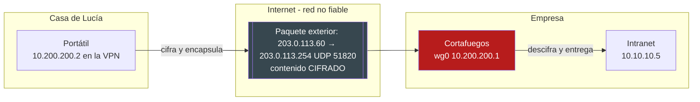
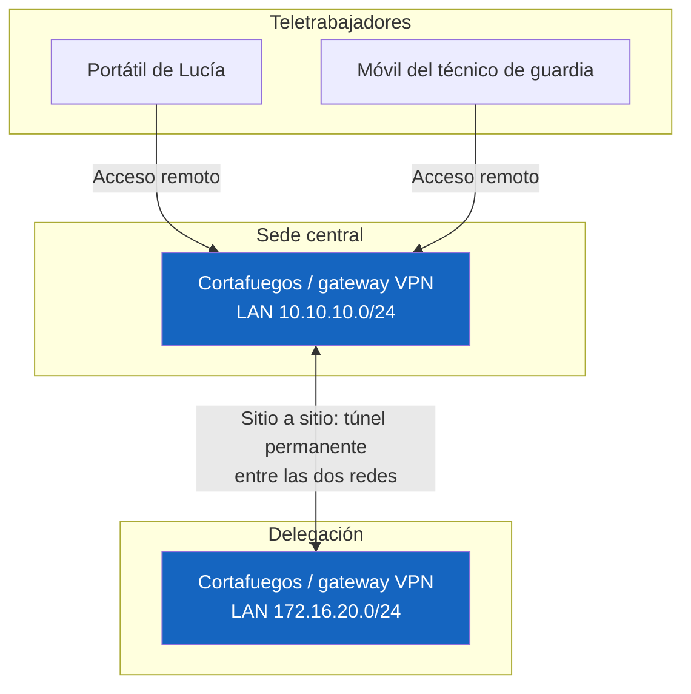
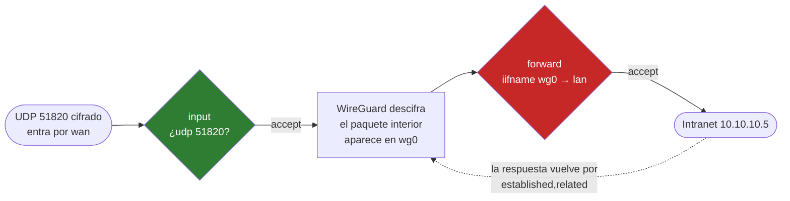
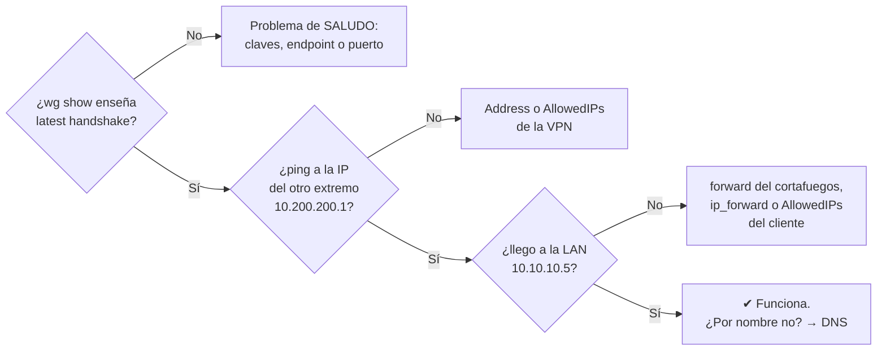

# UD 4: Redes Privadas Virtuales (VPN - WireGuard, IPsec y OpenVPN)

!!! info "Ficha Técnica de la Unidad"
    * **Resultados de Aprendizaje (RA):** RA2 - Implementa mecanismos de seguridad pasiva y control de acceso a redes.
    * **Criterios de Evaluación (CE):** e) Se han identificado las ventajas de una VPN respecto a otras alternativas; f) Se han implementado soluciones de VPN de sitio a sitio y de acceso remoto.
    * **Tecnologías Involucradas:** [WireGuard](https://jmfiorisies.github.io/tech/wireguard/), [OpenVPN e IPsec](https://jmfiorisies.github.io/tech/openvpn-ipsec/)
    * **Marcos y Estándares:** ENS `mp.com.2` y `mp.com.3` (Protección de la confidencialidad e integridad en las comunicaciones); NIST SP 800-77 (Guide to IPsec VPNs); RFC 4301 (IPsec Architecture), RFC 7296 (IKEv2); WireGuard whitepaper (Noise Protocol Framework).

!!! tip "Cómo está organizada esta unidad"
    Esta unidad continúa la UD3: el cortafuegos que construiste allí es la puerta de la empresa, y la VPN es **la única
    forma segura de entrar por ella desde fuera**. El orden importa:

    1. **Bloque 0:** qué es una VPN y qué problema resuelve, sin un solo comando.
    2. **Bloques 1 y 2:** los dos tipos de VPN y las tecnologías que existen.
    3. **Bloque 3:** WireGuard por dentro: claves, `AllowedIPs` y la interfaz `wg0`.
    4. **Bloques 4 y 5:** montas una VPN de acceso remoto en el laboratorio **y la encajas en el cortafuegos de la UD3**.
    5. **Bloque 6:** VPN entre dos sedes (sitio a sitio), con WireGuard e IPsec.
    6. **Bloques 7 a 10:** diagnóstico, registros, casos prácticos y glosario.

    Si es la primera vez que configuras una VPN, **no te saltes el bloque 3**: casi todos los fallos de los bloques 4–6
    se explican por algo que está ahí.

---

## 📖 0. Fundamentos: ¿Qué es una VPN y qué problema resuelve?

### 0.1 El problema: trabajar desde fuera sin abrir la empresa a Internet

En la UD3 dejaste la red de la empresa así: desde Internet **solo** se ve la web de la DMZ (puertos 80 y 443). La LAN,
con la intranet, los ficheros y los equipos de los empleados, es invisible desde fuera. Perfecto… hasta que pasa esto:

- **Lucía trabaja desde casa** dos días a la semana y necesita la intranet, que está en la LAN.
- **El técnico de guardia** tiene que entrar por SSH a un servidor a las tres de la mañana, desde su móvil.
- **La empresa abre una delegación** en otra ciudad, y los empleados de allí necesitan los mismos servidores.

Las «soluciones» rápidas son todas malas:

| Idea rápida | Por qué es mala |
|---|---|
| Publicar la intranet en Internet (DNAT, como la web) | Cualquiera del mundo podría intentar entrar. La intranet no está pensada para estar expuesta |
| Abrir el SSH del servidor a Internet | Recibirá miles de intentos de contraseña al día (lo comprobarás en la UD6) |
| Escritorio remoto expuesto (RDP, VNC) | Es una de las vías de entrada de *ransomware* más frecuentes |
| «Que se lo envíen por correo» | Datos de la empresa fuera de control, sin cifrar y sin registro de quién los tiene |

Lo que se quiere es otra cosa: que **Lucía, desde su casa, esté como si estuviera sentada en la oficina**, pero sin abrir
nada más al resto del mundo. Eso es una **VPN** (*Virtual Private Network*, red privada virtual).

### 0.2 La idea: un túnel cifrado a través de Internet

Una VPN crea un **túnel** entre dos puntos a través de una red en la que no confías (Internet, la wifi de un hotel).
Funciona como meter una carta dentro de otra:

1. El portátil de Lucía quiere mandar un paquete a la intranet (`10.10.10.5`). Ese es el **paquete interior**, con
   direcciones privadas que en Internet no significan nada.
2. Antes de que salga, la VPN **lo cifra entero** y lo mete dentro de **otro paquete**, dirigido a la IP pública del
   cortafuegos de la empresa. Esto se llama **encapsular**.
3. Por Internet solo viaja el paquete exterior: «de la IP de casa de Lucía a la IP pública de la empresa, puerto UDP
   51820». Quien lo intercepte (la wifi del hotel, su operador) ve **un bloque de datos cifrados**, sin saber a qué
   servidor va ni qué pide.
4. El cortafuegos de la empresa recibe el paquete exterior, **lo descifra**, saca el paquete interior y lo entrega en la
   LAN como si hubiera nacido allí.



!!! example "La analogía del sobre dentro del sobre"
    Quieres mandar una carta confidencial al departamento de nóminas de tu empresa. En vez de enviarla tal cual, la metes
    en un **sobre opaco y lacrado** (cifrado) dirigido a la **recepción** de la empresa (el cortafuegos). El cartero solo
    ve «de: tu casa · para: recepción de la empresa». La recepcionista, que tiene el sello para abrir el lacre, saca la
    carta de dentro y la lleva a nóminas por el pasillo interno. Si alguien roba el sobre por el camino, solo tiene un
    sobre lacrado que no puede abrir **ni falsificar**.

### 0.3 Qué protege una VPN… y qué NO

Una VPN aplica a la red lo que viste en la UD1 de criptografía:

| Garantía | Qué significa aquí | Cómo lo consigue |
|---|---|---|
| **Confidencialidad** | Nadie entre los dos extremos puede leer el tráfico | Cifrado simétrico del paquete interior (como el que viste en la UD1) |
| **Integridad** | Nadie puede modificar un paquete por el camino sin que se note | Cada paquete lleva un código de autenticación (MAC) |
| **Autenticación** | Solo entran los equipos autorizados | Cada extremo demuestra quién es con su **clave privada** (asimétrico, UD1) |

!!! warning "Lo que una VPN NO hace (errores muy comunes)"
    * **No te hace anónimo** frente a la empresa: el cortafuegos sabe perfectamente quién eres y qué haces.
    * **No protege el equipo**: si el portátil de Lucía tiene un virus, la VPN lo lleva **directamente** a la LAN. Por eso
      la VPN no puede ser «barra libre» (bloque 5).
    * **No cifra más allá del túnel**: desde el cortafuegos hasta la intranet, el paquete viaja como cualquier otro por la LAN.
    * Las VPN comerciales «para navegar seguro» son otra cosa: llevan tu tráfico a Internet a través de un tercero. Aquí
    hablamos de **VPN corporativas**, para entrar a una red privada.

### 0.4 Vocabulario mínimo que necesitas antes de configurar nada

| Término | Qué es |
|---|---|
| **Túnel** | La conexión cifrada entre dos extremos por la que viajan los paquetes encapsulados |
| **Encapsular** | Meter un paquete entero (cifrado) dentro de otro paquete con otras direcciones |
| **Extremo / *peer*** | Cada uno de los equipos que forman el túnel. En WireGuard todos son *peers*: no hay «servidor» en el protocolo, aunque en la práctica uno espere conexiones |
| ***Endpoint*** | La IP pública y el puerto **reales** a los que hay que enviar los paquetes exteriores (`203.0.113.254:51820`) |
| **Interfaz del túnel** | Una tarjeta de red **virtual** (`wg0`) con su propia IP de la VPN (`10.200.200.1`). Lo que se envía por ella entra en el túnel |
| **Red de la VPN** | El rango de IPs privadas de las interfaces del túnel (`10.200.200.0/24`), distinto de la LAN y de la DMZ |
| ***Split tunnel*** | Por el túnel solo va lo de la empresa; el resto (YouTube, el correo personal) sale directo a Internet |
| ***Full tunnel*** | **Todo** el tráfico del equipo va por el túnel, también la navegación. Más control, más carga para la empresa |

---

## 🗺️ 1. Los Dos Tipos de VPN: Acceso Remoto y Sitio a Sitio



| | **Acceso remoto** (*road warrior*) | **Sitio a sitio** (*site-to-site*) |
|---|---|---|
| Une… | **un equipo** con la red de la empresa | **dos redes enteras** (sede ↔ delegación) |
| ¿Quién monta el túnel? | El propio portátil o móvil (lleva un cliente VPN) | Los dos cortafuegos/gateways; los PCs no saben que existe |
| ¿Cuándo está activo? | Cuando el usuario lo conecta | Siempre (24 h) |
| Autenticación | Por usuario o dispositivo: cada uno con su clave | Entre los dos gateways |
| Ejemplo | Lucía desde casa | La delegación usa el ERP de la sede como si estuviera en el mismo edificio |
| Tecnología habitual | WireGuard, OpenVPN | IPsec, WireGuard |

!!! question "Pregunta de control"
    En la delegación hay 30 empleados. ¿Instalarías un cliente VPN en cada uno de los 30 PCs, o un túnel sitio a sitio
    entre los dos cortafuegos? *(Respuesta: sitio a sitio. Un solo túnel, transparente para los usuarios, que se gestiona
    en un único sitio. El acceso remoto es para personas que se mueven, no para oficinas fijas.)*

### 1.1 Ventajas de una VPN frente a las alternativas (CE e)

| Alternativa | Problema | Lo que aporta la VPN |
|---|---|---|
| Publicar cada servicio en Internet | Cada servicio expuesto es una puerta más que vigilar y parchear | **Una sola puerta** (UDP 51820), autenticada con claves; todo lo demás sigue cerrado |
| Contraseñas en cada servicio | Se adivinan, se reutilizan, se roban por *phishing* | Sin la **clave privada** del dispositivo, el paquete ni siquiera se responde |
| Túneles SSH sueltos (`ssh -L`) | Útiles para un técnico puntual, inmanejables para 50 usuarios | Gestión centralizada: alta y baja de usuarios en un fichero |
| Líneas privadas del operador (MPLS) | Caras y lentas de contratar | Usa Internet, que ya está pagado, con la misma confidencialidad |
| «Zero Trust» / acceso por aplicación | Es la tendencia actual (cada aplicación verifica al usuario) | Hoy la VPN sigue siendo la base; Zero Trust la complementa, no la sustituye de un día para otro |

---

## ⚖️ 2. Tecnologías: WireGuard, OpenVPN e IPsec

| Característica | **IPsec (IKEv2)** | **OpenVPN** | **WireGuard** |
|---|---|---|---|
| Dónde funciona | Capa de red (3), en el kernel | Programa en espacio de usuario (TLS sobre UDP o TCP) | Capa de red (3), en el kernel de Linux |
| Tamaño del código | Muy grande (decenas de miles de líneas) | Grande (depende de OpenSSL) | Mínimo (~4.000 líneas): fácil de auditar |
| Configuración | Compleja (muchas opciones, fácil equivocarse) | Media (certificados, ficheros `.ovpn`) | **Muy sencilla**: un fichero corto por extremo |
| Criptografía | Se negocia entre los extremos | Se negocia (TLS) | **Fija**: ChaCha20-Poly1305, Curve25519, BLAKE2s. No se negocia: no hay cifrados débiles que «degradar» |
| Rendimiento | Alto (aceleración por hardware) | Medio | Muy alto |
| Atraviesa cortafuegos «difíciles» | Regular (varios protocolos y puertos) | **Muy bien** (puede ir por TCP 443, como una web) | Bien (un solo puerto UDP) |
| Dónde la verás | Routers y cortafuegos comerciales, enlaces entre empresas | Empresas con clientes Windows/móviles antiguos | Linux, cortafuegos modernos, móviles, servicios en la nube |

!!! tip "¿Cuál elijo?"
    * **WireGuard** por defecto en sistemas Linux nuevos: es lo que usarás en el laboratorio y en la Práctica 2.
    * **IPsec** cuando el otro extremo es un router o cortafuegos comercial (Cisco, Fortinet…) que no habla WireGuard:
      es el estándar entre fabricantes.
    * **OpenVPN** cuando los clientes están detrás de redes que solo dejan salir web (hoteles, redes corporativas
      ajenas): puede disfrazarse de tráfico HTTPS por TCP 443.

!!! note "Por qué «no negociar» es una ventaja de seguridad"
    En IPsec y OpenVPN los extremos acuerdan qué cifrado usar. Históricamente, muchos ataques consistieron en **engañar**
    a los extremos para que acordaran uno débil (*downgrade*). WireGuard no negocia nada: usa siempre las mismas
    primitivas modernas. Si algún día una se rompe, se publica una versión nueva del protocolo entera, en vez de dejar
    opciones antiguas activadas «por compatibilidad».

---

## 🔑 3. WireGuard por Dentro: Claves, `AllowedIPs` y la Interfaz `wg0`

### 3.1 Un par de claves por extremo (lo que ya sabes de la UD1)

WireGuard autentica con **criptografía asimétrica** (Curve25519), igual que el SSH con claves o los certificados de la UD1:

- Cada extremo genera **su par de claves**: una **privada**, que nunca sale del equipo, y una **pública**, que se le da
  al otro extremo.
- En la configuración de cada extremo va **su propia clave privada** y **la clave pública del otro**.
- No hay contraseñas ni certificados ni autoridad de certificación: la clave pública **es** la identidad del *peer*.

```bash title="Generar un par de claves" linenums="1"
umask 077                                   # los ficheros que se creen, solo legibles por root
wg genkey | tee privada.key | wg pubkey > publica.key
cat privada.key    # p. ej. kOd3...=   -> va en [Interface] PrivateKey de ESTE equipo
cat publica.key    # p. ej. 7Lq9...=   -> se la das al OTRO extremo, para su [Peer] PublicKey
```

!!! danger "El error número uno: cruzar mal las claves"
    En el fichero de cada extremo:

    * `[Interface] PrivateKey` = la **privada de este** equipo.
    * `[Peer] PublicKey` = la **pública del otro** equipo.

    Si pones la pública propia en el `[Peer]`, o la privada del otro, el túnel **no da ningún error**: simplemente no hay
    saludo (*handshake*) y no pasa nada. Es el fallo más frecuente con diferencia.

### 3.2 La interfaz `wg0`

WireGuard crea una **tarjeta de red virtual**, normalmente `wg0`, con su propia IP de la red de la VPN. Todo lo que el
sistema envía por `wg0` se cifra y se manda al *endpoint* del *peer* correspondiente; todo lo que llega cifrado al puerto
de WireGuard se descifra y aparece como si hubiera entrado por `wg0`.

```bash title="Ver la interfaz y el estado del túnel" linenums="1"
ip addr show wg0        # la IP de la VPN, p. ej. 10.200.200.1/24
wg show                 # claves públicas, endpoint, último saludo y bytes enviados/recibidos
```

### 3.3 `AllowedIPs`: la línea más importante (y la más malentendida)

`AllowedIPs` va en cada `[Peer]` y hace **dos cosas a la vez**. WireGuard llama a esto *cryptokey routing*:

1. **Al enviar (es una ruta):** «los paquetes para estas IPs, cífralos con la clave de este *peer* y mándaselos a él».
2. **Al recibir (es un filtro):** «de este *peer* solo acepto paquetes cuya IP de **origen** esté en esta lista». Un
   paquete descifrado correctamente pero con otro origen **se tira**.

| Dónde | `AllowedIPs` | Qué significa |
|---|---|---|
| En el **servidor**, en el `[Peer]` de Lucía | `10.200.200.2/32` | Lo que vaya a la `.2` se manda a Lucía, y de Lucía solo acepto paquetes con origen `.2`. **Siempre `/32` por persona** |
| En el **portátil de Lucía**, en el `[Peer]` de la empresa | `10.10.10.0/24, 10.10.20.0/24, 10.200.200.0/24` | Por el túnel va solo lo de la empresa (LAN, DMZ y VPN): ***split tunnel*** |
| En el portátil, alternativa | `0.0.0.0/0` | **Todo** el tráfico de Lucía va por el túnel, también su navegación: ***full tunnel*** |

!!! warning "`AllowedIPs = 0.0.0.0/0` en el lado equivocado"
    En el **cliente** puede tener sentido (*full tunnel*). En el **servidor**, dentro del `[Peer]` de un usuario, es un
    agujero: le estás diciendo «acepto de este *peer* paquetes con **cualquier** IP de origen», y además todo el tráfico
    del servidor hacia cualquier sitio se intentaría mandar a ese portátil.

### 3.4 Los demás campos de los ficheros

| Campo | Sección | Para qué |
|---|---|---|
| `Address` | `[Interface]` | La IP de este equipo **dentro** de la VPN (`10.200.200.1/24`) |
| `ListenPort` | `[Interface]` | El puerto UDP donde espera conexiones. Solo hace falta en quien «recibe» (el servidor): `51820` |
| `PrivateKey` | `[Interface]` | La clave privada de este equipo |
| `PublicKey` | `[Peer]` | La clave pública del otro extremo |
| `Endpoint` | `[Peer]` | Dónde está el otro **de verdad**: IP pública y puerto. Lo pone el cliente; el servidor lo aprende al recibir el primer paquete |
| `AllowedIPs` | `[Peer]` | Ver 3.3 |
| `PersistentKeepalive` | `[Peer]` | Envía un paquete vacío cada N segundos para que el router de casa (NAT) no olvide la conexión. `25` en clientes detrás de NAT |

### 3.5 Cómo se levanta y se baja: `wg-quick`

```bash title="Ciclo de vida del túnel" linenums="1"
wg-quick up wg0               # lee /etc/wireguard/wg0.conf, crea wg0, pone la IP y las rutas de AllowedIPs
wg-quick down wg0             # lo deshace todo
systemctl enable --now wg-quick@wg0    # que se levante solo al arrancar el sistema
```

!!! note "Ampliación: el saludo de WireGuard"
    Cuando se envía el primer paquete, los dos extremos hacen un **saludo** (*handshake*, patrón `Noise_IK` del *Noise
    Protocol Framework*) en una sola ida y vuelta. De ahí salen **claves de sesión temporales** que se renuevan cada
    2 minutos: aunque alguien robara una clave de sesión, solo podría descifrar ese trozo de tráfico (***Perfect Forward
    Secrecy***). Por eso en `wg show` verás `latest handshake: 1 minute ago` y nunca más de 2–3 minutos si hay tráfico.

---

## 🛠️ 4. Laboratorio: VPN de Acceso Remoto para un Teletrabajador

Es el **mismo laboratorio de la UD3** (el kit `docker-sad-ud34` que tienes en Moodle), que ya tiene un quinto equipo:
`remoto`, el portátil de un teletrabajador conectado a «Internet».

```text
  «Internet» 203.0.113.0/24     DMZ 10.10.20.0/24     LAN 10.10.10.0/24
  internet .50 · remoto .60      web .10               pc .5
              \__________ firewall .254 (wan · dmz · lan) + VPN wg0 10.200.200.1 __________/
```

**Punto de partida:** el cortafuegos de la UD3 funcionando (`./lab.sh comprobar ud3` todo en verde). Desde el `remoto`,
la intranet **no** se ve:

```bash
./lab.sh remoto
curl -m 3 http://10.10.10.5        # nada: la LAN es privada y el cortafuegos no deja entrar
```

### Paso 1 — Las claves de los dos extremos

```bash title="En el firewall (./lab.sh firewall)" linenums="1"
cd /etc/wireguard && umask 077
wg genkey | tee firewall.key | wg pubkey > firewall.pub
cat firewall.pub        # apunta esta clave pública: va en el fichero del portátil
```

```bash title="En el portátil (./lab.sh remoto)" linenums="1"
cd /etc/wireguard && umask 077
wg genkey | tee remoto.key | wg pubkey > remoto.pub
cat remoto.pub          # apunta esta: va en el fichero del firewall
```

!!! tip "Las carpetas son tuyas"
    `/etc/wireguard` del firewall es tu carpeta `firewall/wireguard/`, y la del portátil es `remoto/wireguard/`. Puedes
    copiar las claves públicas de un fichero a otro desde tu ordenador. Las **privadas** no salen nunca de su máquina.

### Paso 2 — El servidor VPN en el firewall

```ini title="firewall/wireguard/wg0.conf" linenums="1"
[Interface]
Address = 10.200.200.1/24
ListenPort = 51820
PrivateKey = <contenido de firewall.key>

# Portátil de un teletrabajador
[Peer]
PublicKey = <contenido de remoto.pub>
AllowedIPs = 10.200.200.2/32
```

### Paso 3 — El cliente en el portátil

```ini title="remoto/wireguard/wg0.conf" linenums="1"
[Interface]
Address = 10.200.200.2/24
PrivateKey = <contenido de remoto.key>

[Peer]
PublicKey = <contenido de firewall.pub>
Endpoint = 203.0.113.254:51820
AllowedIPs = 10.10.10.0/24, 10.10.20.0/24, 10.200.200.0/24
PersistentKeepalive = 25
```

### Paso 4 — Abrir la puerta en el cortafuegos (bloque 5)

Si levantas el túnel ahora, **no habrá saludo**: el cortafuegos de la UD3 tiene `policy drop` en `input` y nadie ha
permitido el UDP 51820. Añade a `firewall/nftables.conf` las dos reglas que explica el bloque 5 y aplícalo:

```bash
./lab.sh aplicar
```

### Paso 5 — Levantar el túnel y comprobarlo

```bash title="Levantar los dos extremos" linenums="1"
./lab.sh vpn                     # hace wg-quick up wg0 en el firewall y en el portátil y enseña «wg show»
```

```text title="Lo que debes ver en wg show (firewall)"
peer: IsB2E+81XY4G...=
  endpoint: 203.0.113.60:50288
  allowed ips: 10.200.200.2/32
  latest handshake: Now
  transfer: 308 B received, 220 B sent
```

```bash title="Desde el portátil (./lab.sh remoto)" linenums="1"
ping -c 2 10.200.200.1               # el otro extremo del túnel
curl http://10.10.10.5               # la intranet: «PC de la LAN · te llega una petición desde 10.200.200.2»
```

Fíjate en el final de esa respuesta: el PC de la LAN ve llegar la petición **desde `10.200.200.2`**, la IP de Lucía en
la VPN. No hay NAT: la empresa sabe exactamente qué teletrabajador hace cada cosa.

### Paso 6 — Comprobar que de verdad va cifrado

```bash title="En el firewall, mientras desde el portátil haces curl a la intranet" linenums="1"
tcpdump -ni wan host 203.0.113.60
```

Solo verás paquetes **UDP al puerto 51820** con datos ilegibles. En ningún momento aparece la petición HTTP a
`10.10.10.5`: viaja dentro del túnel.

```bash title="Comprobación automática" linenums="1"
./lab.sh comprobar ud4
```

!!! success "Criterio de éxito"
    * `wg show` en el firewall: el *peer* con `latest handshake` reciente y bytes en `transfer`.
    * Desde `remoto`, `curl http://10.10.10.5` responde la intranet **y la petición llega desde `10.200.200.2`**.
    * Desde `internet` (sin VPN), la LAN sigue sin verse.
    * `tcpdump` en la `wan` solo ve UDP 51820.

---

## 🧱 5. Encajar la VPN en el Cortafuegos de la UD3

La VPN no sustituye al cortafuegos: **se integra en él**. Sigue un paquete de Lucía hasta la intranet con el mapa de
cadenas de la UD3:



1. El paquete **exterior** va dirigido al propio cortafuegos (`203.0.113.254`), así que pasa por la cadena **`input`**:
   hay que permitir el UDP 51820, y **solo por la `wan`**.
2. WireGuard lo descifra. El paquete **interior** (`10.200.200.2 → 10.10.10.5`) aparece entrando por la interfaz `wg0`.
3. Como no es para el cortafuegos sino para la LAN, pasa por **`forward`**: hay que permitir `wg0 → lan`.
4. La respuesta de la intranet vuelve sola gracias a `ct state established,related accept`, que ya tenías.

```bash title="Las reglas que añade la UD4 (marcadas con «UD4»)" linenums="1"
chain input {
    # ... lo de la UD3 ...
    iifname "wan" udp dport 51820 accept comment "UD4: la VPN escucha en la wan"
}

chain forward {
    # ... lo de la UD3 ...
    iifname "wg0" oifname "lan" accept comment "UD4: teletrabajadores -> LAN"
    iifname "wg0" oifname "dmz" ip daddr 10.10.20.10 tcp dport { 22, 80 } accept comment "UD4: teletrabajadores administran la web"
    iifname "dmz" oifname "lan" drop comment "aislamiento DMZ -> LAN"   # (UD3) sigue igual
}
```

!!! danger "La VPN no es barra libre"
    `iifname "wg0" oifname "lan" accept` deja que **cualquier** usuario de la VPN llegue a **toda** la LAN. Para un
    laboratorio vale; en una empresa real, cada grupo debería llegar solo a lo que necesita. Como cada usuario tiene su IP
    fija en la VPN (`/32`), se filtra igual que en la UD3:

    ```bash
    # Comerciales (10.200.200.10-49): solo el ERP · Técnicos (10.200.200.2-9): todo
    iifname "wg0" ip saddr 10.200.200.10-10.200.200.49 ip daddr 10.10.10.20 tcp dport 443 accept
    iifname "wg0" ip saddr 10.200.200.2-10.200.200.9 oifname "lan" accept
    ```

    Y recuerda lo del bloque 0.3: si el portátil de un usuario tiene un virus, la VPN se lo trae a la LAN. Cuanto menos
    pueda alcanzar cada usuario, menos daño hace.

!!! note "¿Y `ip_forward`?"
    Igual que en la UD3: sin `net.ipv4.ip_forward = 1` el cortafuegos no reenvía nada entre `wg0` y la `lan`. En el
    laboratorio ya viene activado; en un servidor real es la primera cosa que se comprueba.

!!! tip "¿Y si se quiere quitar el SSH de Internet?"
    Este es el uso más típico de la VPN en la vida real: el SSH de los servidores **nunca** se publica en Internet; los
    administradores entran primero por la VPN y desde ahí hacen SSH. Es exactamente lo que proponía el Caso 1 de la UD3.

---

## 🏢 6. VPN Sitio a Sitio: Dos Sedes como una Sola Red

### 6.1 Con WireGuard

Los dos cortafuegos son *peers* el uno del otro. La diferencia con el acceso remoto está en `AllowedIPs`: ahora no es una
IP, es **la red entera de la otra sede**.

```ini title="Sede central · /etc/wireguard/wg0.conf" linenums="1"
[Interface]
Address = 10.255.0.1/30
ListenPort = 51820
PrivateKey = <privada de la sede central>

[Peer]   # Delegación
PublicKey = <pública de la delegación>
Endpoint = 198.51.100.20:51820
AllowedIPs = 10.255.0.2/32, 172.16.20.0/24      # la red de la delegación va por el túnel
PersistentKeepalive = 25
```

```ini title="Delegación · /etc/wireguard/wg0.conf" linenums="1"
[Interface]
Address = 10.255.0.2/30
ListenPort = 51820
PrivateKey = <privada de la delegación>

[Peer]   # Sede central
PublicKey = <pública de la sede central>
Endpoint = 203.0.113.254:51820
AllowedIPs = 10.255.0.1/32, 10.10.10.0/24       # la LAN de la sede va por el túnel
PersistentKeepalive = 25
```

`wg-quick` añade las rutas de `AllowedIPs`: un PC de la delegación que haga `ping 10.10.10.5` manda el paquete a su
puerta de enlace (el cortafuegos de la delegación), que ve la ruta por `wg0` y lo envía cifrado a la sede. **Los PCs no
saben que hay una VPN.** En cada cortafuegos se añaden las reglas de `forward` entre `wg0` y su `lan`, igual que en el
bloque 5.

!!! warning "Las dos redes no pueden solaparse"
    Si la sede y la delegación usan las dos `192.168.1.0/24`, cuando un PC pida `192.168.1.10`… ¿cuál es? Las redes
    unidas por una VPN sitio a sitio **deben tener rangos distintos**. Por eso las empresas planifican el direccionamiento
    de cada sede antes de montar nada.

### 6.2 Con IPsec (strongSwan): cuando el otro extremo es un router comercial

Si la delegación tiene un cortafuegos comercial que no habla WireGuard, el estándar es **IPsec con IKEv2**. La idea es
la misma (dos redes, un túnel), con otro vocabulario:

| WireGuard | IPsec |
|---|---|
| `Address` de los extremos | `left` (yo) y `right` (el otro) |
| `AllowedIPs` | `leftsubnet` / `rightsubnet`: las redes que se unen |
| Claves Curve25519 | PSK (clave compartida) o **certificados X.509** de la PKI de la UD1 |
| Primitivas fijas | `ike=` y `esp=`: hay que fijarlas tú, y fuertes |
| `PersistentKeepalive` | `dpd*` (*Dead Peer Detection*): detecta si el otro se ha caído y rehace el túnel |

```ini title="/etc/ipsec.conf (sede central)" linenums="1"
config setup
    charondebug="ike 2, knl 2, cfg 2"

conn sede-central-a-delegacion
    keyexchange=ikev2
    authby=psk
    left=%defaultroute
    leftid=@sede-central.asir-corp.local
    leftsubnet=10.10.10.0/24
    right=198.51.100.20
    rightid=@delegacion.asir-corp.local
    rightsubnet=172.16.20.0/24
    ike=aes256gcm16-sha384-ecp384!      # el «!» obliga a usar ESTO y nada más débil
    esp=aes256gcm16-ecp384!
    ikelifetime=8h
    lifetime=1h
    dpddelay=30
    dpdtimeout=120
    dpdaction=restart
    auto=start
```

```text title="/etc/ipsec.secrets" linenums="1"
@sede-central.asir-corp.local @delegacion.asir-corp.local : PSK "CLAVE_PRECOMPARTIDA_ALTA_ENTROPIA_MIN_32_CARACTERES"
```

```bash title="Gestión con strongSwan" linenums="1"
systemctl enable --now strongswan-starter
ipsec up sede-central-a-delegacion
ipsec statusall                  # estado de cada túnel (Security Association)
```

!!! warning "PSK o certificados"
    Una **PSK** (clave precompartida) es cómoda para un túnel entre dos sedes, pero es un secreto simétrico: si se filtra
    (un correo, una captura de pantalla), hay que cambiarla a la vez en los dos extremos. En sistemas de categoría ALTA del
    ENS se usan **certificados X.509** de la PKI corporativa (UD1): se revoca el de un extremo sin tocar el resto.

!!! note "Ampliación: OpenVPN"
    OpenVPN usa certificados (una pequeña PKI, como la de la UD1) y un fichero `.ovpn` por usuario. Su gran ventaja es
    que puede funcionar por **TCP 443**, así que atraviesa redes que solo dejan salir tráfico web. Lo verás en
    entornos con muchos clientes Windows o móviles antiguos. La idea de túnel, claves y reglas del cortafuegos es la
    misma de esta unidad.

---

## 🩺 7. Diagnóstico: Cuando la VPN No Funciona

Ve **en este orden**. Cada paso depende del anterior:



| Síntoma | Causa probable | Cómo comprobarlo |
|---|---|---|
| `wg show` sin `latest handshake` | Claves cruzadas mal (bloque 3.1) | Compara la pública de cada `[Peer]` con `wg show` del otro extremo |
| Sin *handshake* | El cortafuegos no deja entrar el UDP 51820 | `nft list ruleset -a`: ¿el contador de la regla `udp dport 51820` sube? |
| Sin *handshake* | `Endpoint` equivocado | ¿IP pública y puerto correctos? `tcpdump -ni wan udp port 51820` en el servidor |
| Hay *handshake* pero no llego a la LAN | Falta `forward` de `wg0` a `lan` | El contador de la política `drop` de `forward` sube con cada intento |
| Hay *handshake* pero no llego a la LAN | `AllowedIPs` del cliente sin la red `10.10.10.0/24` | `ip route` en el cliente: ¿la `10.10.10.0/24` va por `wg0`? |
| Llego a la LAN pero la respuesta no vuelve | Falta `ct state established,related accept`, o la LAN no sabe volver | `tcpdump -ni lan` en el cortafuegos: ¿sale la respuesta? |
| Funciona un rato y se corta | Cliente detrás de NAT sin `PersistentKeepalive` | Añade `PersistentKeepalive = 25` en el cliente |
| Páginas que cargan a medias | MTU: el paquete con el túnel no cabe | Baja `MTU = 1380` en `[Interface]` |
| Funciona por IP pero no por nombre | El cliente no usa el DNS de la empresa | `DNS = 10.10.10.53` en el `[Interface]` del cliente |

---

## 🛡️ 8. Monitoreo, Registros y Normativa

| Qué mirar | Dónde | Qué te dice |
|---|---|---|
| Estado del túnel | `wg show` / `wg show wg0 dump` | Qué *peers* han saludado, cuándo y cuántos bytes |
| Quién intenta conectar | Contador de `udp dport 51820` en `nft list ruleset -a` | Intentos al puerto (válidos o no) |
| Qué hace cada usuario | Reglas de `forward` con `log prefix` por IP de la VPN | Qué servicios de la LAN usa cada teletrabajador |
| IPsec | `ipsec statusall` y `/var/log/syslog` (*daemon*) | Negociación IKE, errores de autenticación, caídas (DPD) |

```bash title="Vigilar los saludos de todos los peers" linenums="1"
watch -n5 'wg show wg0 latest-handshakes'
```

!!! note "Normativa y Estándares (ENS / ISO 27001 / RFC)"
    WireGuard, por diseño, **no guarda registros** de las conexiones (para no dejar metadatos). Si el ENS exige
    trazabilidad de los accesos remotos (`op.exp.8`), se consigue en el **cortafuegos**: reglas de `forward` con `log`
    por IP de la VPN (cada usuario tiene la suya, `/32`), enviadas al SIEM de la UD8. Las medidas `mp.com.2` y `mp.com.3`
    exigen confidencialidad e integridad en las comunicaciones que salen del perímetro: es exactamente lo que da el túnel.

---

## ❓ 9. Casos Prácticos y Autoevaluación

**Caso 1 — Un cliente no reconecta al cambiar de red móvil.** *Resolución:* `PersistentKeepalive = 25` en el cliente.
Sin él, el NAT del operador olvida la conexión y el servidor no puede volver a contactar con el cliente.

**Caso 2 — Un túnel IPsec se cae cada pocas horas.** *Resolución:* revisar `ikelifetime` y `lifetime` en los dos
extremos (deben coincidir) y que `dpdtimeout` no sea tan agresivo que una red con cortes breves tire el túnel.

**Caso 3 — Un usuario de la VPN llega a toda la red.** En el servidor, su `[Peer]` tiene `AllowedIPs = 0.0.0.0/0` y en
`forward` hay un `iifname "wg0" accept` general. *Resolución:* `/32` por usuario en el servidor y reglas de `forward` por
IP de origen de la VPN (bloque 5).

**Caso 4 — Roban un portátil con la clave privada de WireGuard.** *Resolución:* quitar inmediatamente su `[Peer]` del
servidor (`wg set wg0 peer <PUBLICA> remove` y borrarlo del `wg0.conf`), generar claves nuevas al usuario y exigir
cifrado de disco (LUKS, BitLocker) en los portátiles. Con WireGuard no hay que cambiar nada a los demás usuarios.

**Caso 5 — La PSK del túnel con la delegación se envió por correo.** *Resolución:* cambiarla en los dos extremos por un
canal seguro y migrar el túnel a certificados de la PKI corporativa (UD1).

!!! question "Autoevaluación final antes de la práctica"
    1. ¿Por qué el UDP 51820 se permite en la cadena `input` y el tráfico de Lucía hacia la intranet en `forward`?
    2. En el fichero del servidor, ¿qué clave va en `PrivateKey` y cuál en el `[Peer]`? ¿Y en el del cliente?
    3. Explica las dos funciones de `AllowedIPs` con el ejemplo del `[Peer]` de Lucía en el servidor (`10.200.200.2/32`).
    4. ¿Qué diferencia hay entre *split tunnel* y *full tunnel*? ¿Qué línea del cliente lo decide?
    5. Una delegación con 30 PCs: ¿acceso remoto o sitio a sitio? ¿Por qué las dos redes no pueden ser la misma?
    6. ¿Qué ves con `tcpdump` en la `wan` cuando Lucía usa la intranet? ¿Qué verías sin VPN?
    7. ¿Por qué una VPN no protege la LAN de un portátil infectado? ¿Qué harías en el cortafuegos para limitar el daño?

---

## 📋 10. Glosario Rápido de Repaso

| Término | Definición en una línea |
|---|---|
| **VPN** | Red privada «virtual» que une equipos o redes a través de Internet con un túnel cifrado |
| **Túnel** | La conexión cifrada entre dos extremos por la que viajan los paquetes encapsulados |
| **Encapsular** | Meter un paquete cifrado dentro de otro, con las IPs públicas de los extremos |
| **Peer** | Cada extremo de un túnel WireGuard, identificado por su clave pública |
| **Endpoint** | IP pública y puerto reales del otro extremo |
| **AllowedIPs** | Las IPs que van por el túnel hacia ese *peer* (ruta) y las únicas que se aceptan de él (filtro) |
| **Handshake** | El saludo inicial con el que dos *peers* acuerdan claves de sesión |
| **Split / full tunnel** | Por el túnel va solo lo de la empresa / va todo el tráfico del equipo |
| **Acceso remoto** | VPN de un equipo (teletrabajador) a la red de la empresa |
| **Sitio a sitio** | VPN permanente entre dos redes enteras (sede y delegación) |
| **IKEv2 / IPsec** | Estándar de VPN entre fabricantes; IKE negocia las claves e IPsec (ESP) cifra los paquetes |
| **PSK** | Clave precompartida: un secreto simétrico que conocen los dos extremos |
| **PFS** | *Perfect Forward Secrecy*: robar una clave de sesión no permite descifrar el resto del tráfico |
